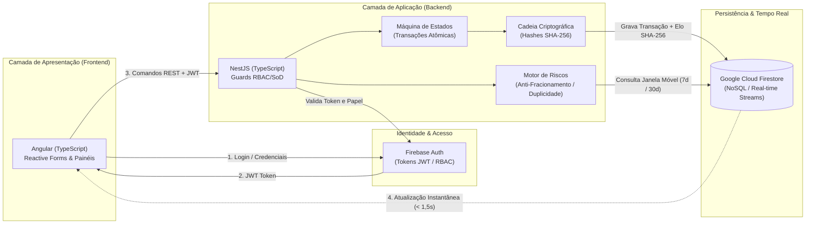
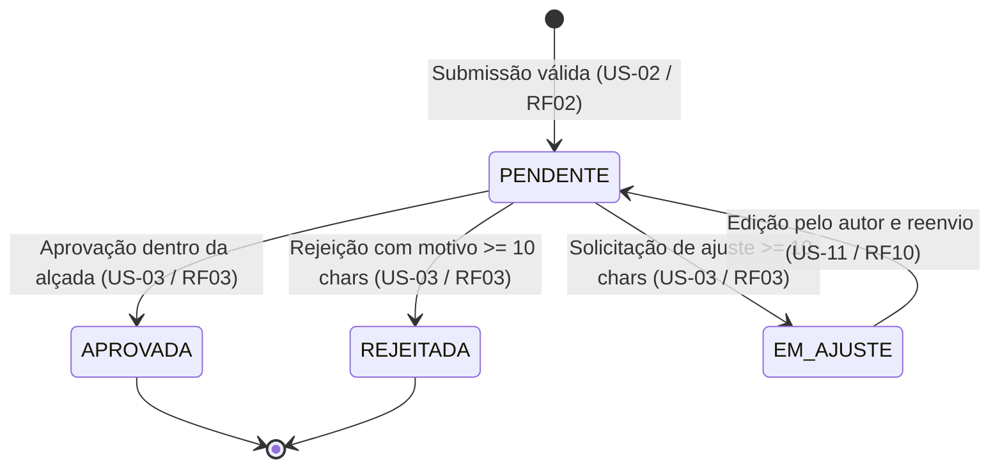
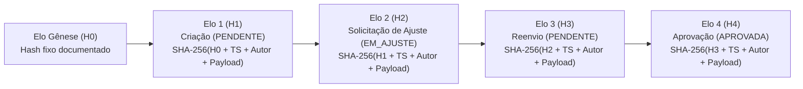

# Arquitetura do Sistema

A arquitetura do sistema **Alçadas** foi desenhada sob o paradigma **Cloud-Native**, priorizando alta disponibilidade, sincronização em tempo real e o rigor necessário para suportar regras estritas de governança financeira, segregação de funções (*SoD*) e auditoria imutável.

---

## 1. Visão Geral e Stack Tecnológica

O sistema adota **TypeScript de ponta a ponta** estruturado em um **monorepo gerenciado pelo Nx**, eliminando falhas de contrato entre *frontend* e *backend* e acelerando o ciclo de desenvolvimento.

### Componentes da Arquitetura

| Camada | Tecnologia | Responsabilidades Principais |
| :--- | :--- | :--- |
| **Frontend** | **Angular** (TypeScript) | Gerenciamento de fluxos complexos de dados, formulários dinâmicos (*Reactive Forms*), validação em tela, tratamento explícito de estados (*loading*, *empty*, *error*) e consumo de *streams* em tempo real sem recarregar a página (`RNF01`, `RNF08`). |
| **Backend** | **NestJS** (TypeScript) | Arquitetura em camadas que centraliza e blinda operações críticas: máquina de estados concorrente, cálculo matemático anti-fracionamento, detecção de duplicidade e geração de selos criptográficos SHA-256 (`RF03`–`RF12`, `RNF02`). |
| **Persistência e Tempo Real** | **Google Cloud Firestore** | Banco NoSQL orientado a documentos em nuvem, responsável pela persistência transacional, isolamento lógico entre *tenants* (`RNF07`) e emissão nativa de eventos em tempo real para as interfaces ativas em menos de 1,5 s (`RNF01`). |
| **Autenticação e Identidade** | **Firebase Auth** | Validação segura de credenciais e emissão de tokens JWT. Integrado aos *Guards* do NestJS e do Angular, garante o Controle de Acesso Baseado em Papéis (**RBAC**) e a **Segregação de Funções (*SoD*)** (`RNF03`). |
| **Infraestrutura e Ambientes** | **Docker & Docker Compose** | Conteinerização imutável da aplicação e orquestração local com emuladores do Firebase (Auth e Firestore) via `docker compose up` (`RNF05`, `RNF10`). |

---

## 2. Máquina de Estados e Controle de Concorrência

O núcleo operacional do **Alçadas** é uma máquina de estados que controla o ciclo de vida de cada solicitação financeira (`RF03`, `RF10`, `RF11`).

### Decisões Concorrentes e Transações Atômicas (`RF11` / `RN11`)

Para impedir que dois aprovadores (ou um diretor titular e seu substituto delegado) registrem decisões simultâneas conflitantes sobre o mesmo pedido:

- Toda mudança de estado ocorre via **transação atômica** verificando a **versão atual** do documento;
- Caso duas requisições concorrentes cheguem para a mesma versão, exatamente **uma retorna sucesso** e a **segunda é recusada com `HTTP 409 Conflict`** (`US-05`);
- Solicitações em estados terminais (`APROVADA` ou `REJEITADA`) rejeitam qualquer nova tentativa de decisão com `HTTP 409` (`CA-03.4`).

---

## 3. Trilha de Auditoria Criptográfica (SHA-256)

Para garantir **imutabilidade e integridade criptográfica** (`RF07`, `RF08`, `RNF02`), cada evento ou transição de estado gera automaticamente um elo imutável encadeado ao evento anterior:

$$H_n = \text{SHA-256}(H_{n-1} \parallel \text{timestamp}_{\text{UTC}} \parallel \text{authorId} \parallel \text{payload})$$

- **Proteção contra Adulteração (`RN08` / `US-08`):** Qualquer alteração de 1 byte diretamente no banco de dados, remoção ou inserção indevida de elos invalida o recálculo determinístico da cadeia e destaca o registro como `"Inconsistente / Adulterado"` em menos de **1 segundo** (para cadeias de até 1.000 elos).
- **Bloqueio de Mutação via API (`CA-07.3`):** Nenhuma rota permite edição ou exclusão de elos da trilha, retornando `HTTP 403` ou `HTTP 405` mesmo para o perfil Administrador.
- **Exportação Auditável (`RF09` / `US-13`):** Exportação em **CSV** ou **JSON** contendo 100% dos elos, *hashes* atuais, *hashes* anteriores e carimbo UTC ISO 8601 da extração para verificação externa independente.

---

## 4. Motor de Riscos, RBAC e Segregação de Funções (SoD)

### 4.1. Prevenção de Fracionamento e Duplicidade
- **Anti-Fracionamento (`RF05` / `RN05` / `US-06`):** Ao submeter uma solicitação, o backend soma os pedidos do mesmo **centro de custo e categoria** dentro de uma **janela móvel de 30 dias**. Se a soma ultrapassar o teto da alçada inferior (ex.: soma de R$ 5.000,01 para teto de R$ 5.000,00), o pedido é bloqueado para a alçada inferior e escalonado automaticamente ao nível superior.
- **Detecção de Duplicidade (`RF06` / `RN06` / `US-12`):** Lançamentos com correspondência exata de **valor, centro de custo e fornecedor** em intervalo **inferior a 7 dias** recebem alerta visual `"Suspeita de duplicidade"` no painel do aprovador em até 1,5 s.

### 4.2. Segregação de Funções (*SoD*) e Delegação Temporária
- **Bloqueio de Autoaprovação (`RN03` / `RN12` / `US-04`):** O solicitante jamais pode aprovar o próprio pedido (`HTTP 403`). Mesmo que um usuário receba uma delegação temporária ativa de um diretor, o sistema bloqueia (`HTTP 403`) qualquer tentativa de aprovar solicitações criadas por ele mesmo e registra o bloqueio na trilha com motivo `SOD`.
- **Vigência Automática de Delegação (`RF04` / `RN04` / `US-10`):** Toda delegação exige data/hora de início e término, expirando instantaneamente ao fim da vigência e gerando elos de criação e expiração na trilha de auditoria.
- **Isolamento Multi-tenant (`RNF07` / `US-15`):** Isolamento lógico estrito entre organizações/clínicas, retornando `HTTP 403` ou `404` em qualquer tentativa de acesso cruzado.

---

## 5. Conformidade com a LGPD, Observabilidade e Custos em Nuvem

- **Privacidade e LGPD (`RNF04`, `RNF09`):** Coleta estrita de dados corporativos necessários à trilha legal (nome completo, e-mail institucional, cargo/papel, ID de usuário e endereço IP de origem), com retenção de **5 anos após o encerramento do exercício fiscal** e posterior anonimização. Logs técnicos de aplicação são higienizados para exibir **0 ocorrências de PII, senhas ou tokens**.
- **Desenvolvimento em Emuladores e Controle Orçamentário (`RNF06`, `RNF10`):** O ambiente local sobe integralmente com `docker compose up` utilizando emuladores do Firebase Auth e Firestore, mantendo o gasto na Google Cloud Platform (GCP) abaixo de **US$ 5,00** até a Semana 4 e entre **US$ 4,00 e US$ 10,00** na operação total do ciclo (respeitando o teto de **US$ 50,00** com alertas em 50%, 80% e 100%).
