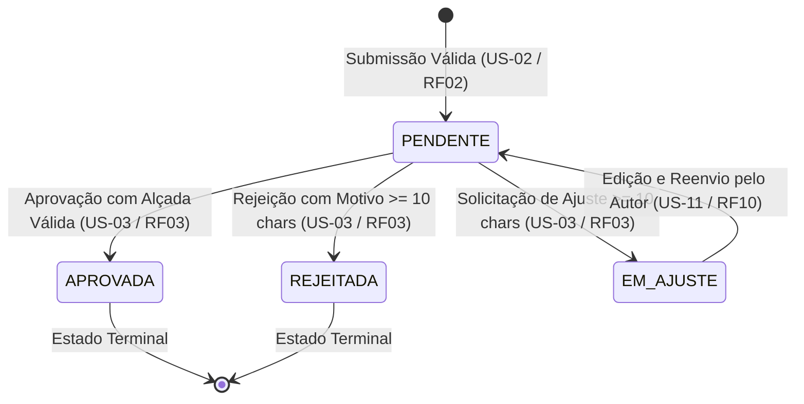

# ADR-005: Máquina de Estados Finita e Controle de Concorrência Otimista (OCC)

## Status
**Aceito** (Checkpoint 1)

## Data
2026-10-18

---

## Contexto

O ciclo de vida de uma solicitação financeira no sistema **Alçadas** obedece a regras de governança estritas e fluxos de aprovação sequenciais (`RF03`, `RF10`, `RF11`). 

Um dos desafios centrais de engenharia do projeto é o tratamento de **Decisões Concorrentes** (`RF11` / `RN11` / `US-05`):
- Em organizações corporativas, um aprovador titular (ex.: Diretor Geral) e seu substituto delegado temporário podem tentar registrar decisões simultâneas sobre o mesmo pedido;
- Alternativamente, dois aprovadores em tela podem clicar em `"Aprovar"` e `"Rejeitar"` na mesma fração de segundo;
- Se o sistema processar ambas as requisições em paralelo sem isolamento transacional, podem ocorrer estados inconsistentes (*race condition*), duplicidade de aprovações e quebra da trilha de auditoria.

Além disso, é imperativo que qualquer tentativa de transição inválida (ex.: tentar aprovar um pedido que já está em status `REJEITADA` ou `EM_AJUSTE`) seja sumariamente rejeitada pelo backend com código de erro HTTP apropriado (`409 Conflict` ou `400 Bad Request`).

---

## Decisão

Adotamos a implementação de uma **Máquina de Estados Finita (FSM - *Finite State Machine*)** no backend NestJS, respaldada por **Controle de Concorrência Otimista (OCC - *Optimistic Concurrency Control*)** e transações atômicas nativas do Google Cloud Firestore.

### 1. Estados Reconhecidos

O ciclo de vida admite 4 estados formais:



- **`PENDENTE`:** Solicitação submetida pelo solicitante com dados validados, aguardando parecer de um aprovador habilitado dentro da faixa financeira do centro de custo;
- **`EM_AJUSTE`:** Solicitação devolvida ao solicitante para complementação de informações ou correção de notas fiscais;
- **`APROVADA` (Terminal):** Solicitação formalmente aprovada. Nenhuma transição posterior é permitida;
- **`REJEITADA` (Terminal):** Solicitação formalmente reprovada. Nenhuma transição posterior é permitida.

### 2. Persistência de Estado e Transações Atômicas

Cada documento de solicitação armazena explicitamente os campos:
- `status`: Enum textual (`PENDENTE`, `EM_AJUSTE`, `APROVADA`, `REJEITADA`);
- `versao`: Inteiro incremental iniciando em `1` e incrementado a cada transição de estado bem-sucedida;
- `updatedAt`: Timestamp UTC ISO 8601 da última alteração.

Toda transição de estado é executada dentro de uma **transação atômica** (`firestore.runTransaction()`):

```typescript
// Pseudocódigo da transição atômica no NestJS / Firestore
await firestore.runTransaction(async (transaction) => {
  const docRef = firestore.collection('solicitacoes').doc(solicitacaoId);
  const snapshot = await transaction.get(docRef);
  
  if (!snapshot.exists) {
    throw new NotFoundException('Solicitação não encontrada');
  }

  const solicitacao = snapshot.data();

  // 1. Verificação de versão esperada (Optimistic Concurrency Control)
  if (solicitacao.versao !== versaoEsperada) {
    throw new ConflictException({
      statusCode: 409,
      error: 'Conflict',
      message: 'A solicitação foi modificada por outro aprovador simultaneamente.',
    });
  }

  // 2. Validação da máquina de estados
  if (solicitacao.status !== StatusSolicitacao.PENDENTE) {
    throw new ConflictException({
      statusCode: 409,
      error: 'Conflict',
      message: `Transição inválida: a solicitação já se encontra em estado terminal (${solicitacao.status}).`,
    });
  }

  // 3. Validação de Regras de Negócio e SoD
  if (solicitacao.solicitanteId === aprovadorId) {
    throw new ForbiddenException('SoD: O solicitante não pode aprovar a própria solicitação.');
  }

  // 4. Gravação atômica do novo estado e incremento de versão
  const novaVersao = solicitacao.versao + 1;
  transaction.update(docRef, {
    status: StatusSolicitacao.APROVADA,
    versao: novaVersao,
    updatedAt: new Date().toISOString(),
  });

  // 5. Gravação encadeada do Elo de Auditoria (ADR-006)
  const novoEloRef = firestore.collection('trilha_auditoria').doc();
  transaction.set(novoEloRef, eloAuditoriaPayload);
});
```

### 3. Rejeição de Transições Inválidas e Tratamento de Erros

- **Concorrência (`US-05`):** Quando duas requisições de decisão chegam para a mesma solicitação com a mesma versão base, o Firestore concede o commit à primeira que alcançar a base de dados. A segunda requisição sofre colisão de versão durante o commit transacional e o NestJS retorna obrigatoriamente **`HTTP 409 Conflict`** (`CA-05.1`);
- **Tentativas de Mutação em Estados Terminais (`CA-03.4`):** Requisições que tentem aprovar ou rejeitar uma solicitação já em `APROVADA` ou `REJEITADA` recebem **`HTTP 409 Conflict`**;
- **Rejeição/Ajuste sem Justificativa:** Rejeições e pedidos de ajuste exigem texto explicativo de no mínimo 10 caracteres (`CA-03.2`, `CA-03.3`). Se a justificativa for ausente ou tiver menos de 10 caracteres, o NestJS rejeita com **`HTTP 400 Bad Request`** antes de abrir a transação;
- **Violação de Alçada ou SoD:** Tentativa de aprovação por solicitante ou com valor superior ao teto configurado resulta em **`HTTP 403 Forbidden`** e registro de evento na trilha.

### 4. Referência à Tabela de Transições

Todas as combinações possíveis de origem, evento, papel autorizado, guardas de negócio, destino e log criptográfico gerado estão formalmente tabuladas no documento **[Tabela de Transições da Máquina de Estados](../tabela-transicoes.md)**.

---

## Consequências

### Positivas
- **Impossibilidade de Condições de Corrida:** A combinação de OCC + transação atômica do Firestore garante consistência forte em decisões concorrentes;
- **Comportamento Determinístico e Testável:** Cada transição de estado é uma função pura e isolada, facilitando testes unitários e de integração (`apps/api-e2e`);
- **Auditoria Totalmente Conectada:** Como o novo elo de auditoria é gravado no mesmo bloco transacional da mudança de estado, nunca existirá uma mudança de status sem seu respectivo elo na cadeia de hash.

### Negativas / Mitigações
- **Necessidade de Retry no Cliente em Conflito:** Caso ocorra `HTTP 409`, a interface do usuário precisa receber o erro com clareza.  
  *Mitigação:* O frontend Angular exibe notificação explicativa informando que a solicitação acabou de ser decidida por outro usuário, atualizando a visualização instantaneamente via listener em tempo real (`RNF01`).
