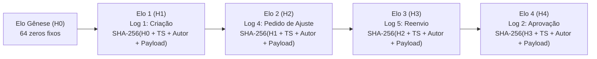

# ADR-006: Trilha de Auditoria Criptográfica com Hashes SHA-256 e Eventos Encadeados

## Status
**Aceito** (Checkpoint 1)

## Data
2026-10-18

---

## Contexto

Um dos compromissos centrais do sistema **Alçadas** é a **Governança e Rastreabilidade Operacional Inegociável** (`RF07`, `RF08`, `RNF02`, `US-07`, `US-08`).

Em sistemas tradicionais de aprovação de despesas, a trilha de auditoria frequentemente consiste em logs em tabelas convencionais com permissão de escrita irrestrita para administradores de banco de dados (DBAs). Isso viabiliza fraudes corporativas através da alteração silenciosa de registros no banco de dados para encobrir aprovações irregulares, compras acima da alçada ou desvios de recursos.

Para blindar o sistema contra adulterações:
1. Cada alteração de estado ou evento de risco deve gerar um registro imutável;
2. Cada registro deve ser criptograficamente encadeado ao registro anterior, formando uma cadeia contínua de blocos de auditoria (*tamper-evident audit trail*);
3. Qualquer modificação de 1 byte em qualquer ponto do banco de dados deve ser detectada deterministicamente em **menos de 1 segundo** por rotinas de verificação (`RN08` / `CA-08.1`), marcando o registro afetado como `"Inconsistente / Adulterado"`;
4. Nenhuma rota da API deve permitir alteração ou deleção de elos de auditoria (`CA-07.3`).

---

## Decisão

Adotamos uma arquitetura de **Trilha de Auditoria Criptográfica Encadeada com Hashes SHA-256**, implementada no backend NestJS e armazenada em coleção protegida do Firestore.

### 1. Algoritmo de Cálculo e Ligação entre Registros

A cadeia inicia-se a partir de um **Elo Gênese ($H_0$)** fixo e determinístico documentado no sistema:

$$H_0 = \text{"0000000000000000000000000000000000000000000000000000000000000000"}$$

Para cada novo evento $n$ ($n \ge 1$), o hash do elo ($H_n$) é calculado aplicando o algoritmo **SHA-256** sobre a concatenação estrita e canônica das seguintes propriedades:

$$H_n = \text{SHA-256}(H_{n-1} \parallel \text{timestamp}_{\text{UTC}} \parallel \text{authorId} \parallel \text{tipoEvento} \parallel \text{payloadCanônico})$$

Onde:
- $H_{n-1}$ é a representação hexadecimal de 64 caracteres do hash do elo imediatamente anterior na sequência;
- $\text{timestamp}_{\text{UTC}}$ é a data e hora do evento no padrão ISO 8601 estrito (ex.: `2026-10-20T18:30:00.000Z`);
- $\text{authorId}$ é o identificador único do usuário autor da ação (ou `"SYSTEM"` em eventos automatizados);
- $\text{tipoEvento}$ é o identificador textual do evento (Logs 1 a 10);
- $\text{payloadCanônico}$ é a serialização JSON determinística dos dados do evento (chaves ordenadas alfabeticamente para garantir reproducibilidade de 100%).

### 2. Catálogo Formal de Eventos da Cadeia (Logs 1 a 10)

O sistema reconhece e audita formalmente 10 tipos de eventos obrigatórios na trilha:

| Código | Identificador | Gatilho / Momento de Registro | Dados Obrigatórios no Payload |
| :--- | :--- | :--- | :--- |
| **Log 1** | `CRIACAO_SOLICITACAO` | Submissão bem-sucedida de novo pedido (`US-02`) | `solicitacaoId`, `centroCustoId`, `valor`, `categoria`, `justificativa` |
| **Log 2** | `APROVACAO` | Parecer favorável emitido por aprovador competente (`US-03`) | `solicitacaoId`, `aprovadorId`, `cargo`, `limiteAlcada`, `observacao` |
| **Log 3** | `REJEICAO` | Reprovação formal da solicitação (`US-03`) | `solicitacaoId`, `aprovadorId`, `motivo` (mínimo 10 caracteres) |
| **Log 4** | `PEDIDO_AJUSTE` | Solicitação devolvida ao autor para correções (`US-03`) | `solicitacaoId`, `aprovadorId`, `motivo` (mínimo 10 caracteres) |
| **Log 5** | `REENVIO_SOLICITACAO` | Submissão da solicitação após edição pelo autor (`US-11`) | `solicitacaoId`, `camposAlterados`, `novaJustificativa` |
| **Log 6** | `DELEGACAO_CRIADA` | Concessão temporária de alçada para usuário substituto (`US-10`) | `deleganteId`, `delegadoId`, `dataInicio`, `dataFim`, `alcadaTeto` |
| **Log 7** | `DELEGACAO_EXPIRADA` | Encerramento automático da vigência da delegação (`US-10`) | `deleganteId`, `delegadoId`, `timestampExpiracao` |
| **Log 8** | `BLOQUEIO_SOD` | Tentativa barrada de autoaprovação ou conflito de função (`US-04`) | `solicitacaoId`, `tentativaAprovadorId`, `motivoBloqueio: "SOD_AUTOAPROVACAO"` |
| **Log 9** | `BLOQUEIO_FRACIONAMENTO` | Trava automática por suspeita de fracionamento de compras (`US-06`) | `solicitacaoId`, `somaJanela30d`, `tetoAlcada`, `pedidosCorrelatosIds` |
| **Log 10** | `ALERTA_DUPLICIDADE` | Sinalização de lançamento idêntico em janela inferior a 7 dias (`US-12`) | `solicitacaoId`, `pedidoDuplicadoId`, `valorIdentico`, `fornecedor` |

### 3. Procedimento de Verificação de Integridade da Trilha

A conferência da higidez da trilha é exposta pela rota `POST /api/solicitacoes/{id}/trilha/verificar` e funciona da seguinte forma:

1. **Recuperação Ordenada:** O backend recupera todos os elos associados à solicitação ordenados crescentemente pelo campo `sequencia` ($1, 2, 3 \dots k$);
2. **Recálculo Sequencial:** O algoritmo inicia em $H_0$. Para cada elo $i$, o sistema recalcula $H'_i = \text{SHA-256}(H'_{i-1} \parallel \text{timestamp}_i \parallel \text{authorId}_i \parallel \text{tipoEvento}_i \parallel \text{payloadCanônico}_i)$;
3. **Comparação Criptográfica:** Compara-se o hash recalculado $H'_i$ com o hash persistido $H_i$:
   - Se $H'_i === H_i$ para todos os elos, o status retornado é `"INTEGRA"`;
   - Se em qualquer elo $j$ houver divergência ($H'_j \ne H_j$), o algoritmo interrompe imediatamente o processamento, aponta o elo violado $j$, a diferença detectada e classifica a trilha como `"Inconsistente / Adulterado"`;
4. **Métrica de Desempenho:** O algoritmo opera em memória ($O(n)$) e executa o recálculo de cadeias de até 1.000 elos em menos de **100 milissegundos**, atendendo com folga a exigência de ser inferior a 1 segundo (`RN08` / `CA-08.1`).

### 4. Proteção de Acesso e Imutabilidade na API

- **Rotas de Mutação Inexistentes:** A API não implementa métodos `PUT`, `PATCH` ou `DELETE` para os recursos de auditoria (`/api/solicitacoes/{id}/trilha`);
- **Segurança no Firestore:** As regras de segurança barram `allow update, delete: if false;` impedindo inclusive que administradores apaguem elos via console web sem deixar rastro.

---

## Consequências

### Positivas
- **Inviolabilidade Matemática:** Qualquer fraude cometida diretamente no banco de dados (ex.: alteração do valor de R$ 4.000 para R$ 14.000) rompe a cadeia em cascata e é imediatamente desmascarada;
- **Exportação Auditável Independente:** A cadeia pode ser exportada em CSV ou JSON (`RF09` / `US-13`) para que órgãos de fiscalização ou peritos externos verifiquem os hashes utilizando qualquer ferramenta padrão (ex.: utilitário `sha256sum`);
- **Conformidade Legal:** Atende integralmente a requisitos regulatórios corporativos e de auditoria fiscal.

### Negativas / Mitigações
- **Imutabilidade Exige Rigor Canônico:** Qualquer variação na serialização JSON de espaços em branco ou ordem de chaves alteraria o hash.  
  *Mitigação:* Utilização de biblioteca de serialização canônica padronizada (`fast-json-stable-stringify`) antes de alimentar a função hash SHA-256.
