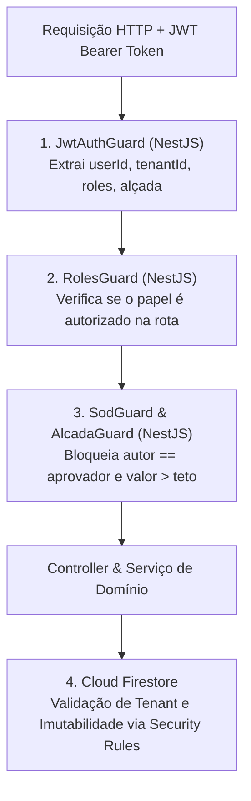

# ADR-007: Controle de Acesso Baseado em Papéis (RBAC) e Segregação de Funções (SoD)

## Status
**Aceito** (Checkpoint 1)

## Data
2026-10-18

---

## Contexto

Em sistemas de gestão financeira corporativa, falhas de autorização e conflito de interesse representam os maiores vetores de fraude e desvios operacionais. No sistema **Alçadas**, o controle de acesso precisa garantir:
1. **Segregação de Funções (*Separation of Duties - SoD*):** Quem solicita uma compra ou reembolso não pode, sob hipótese alguma, aprová-la (`RF03`, `RN03`, `RN12`, `US-04`);
2. **Respeito aos Tetos de Alçada:** Cada aprovador possui um limite financeiro fixo atrelado ao seu cargo/função (ex.: Gerente até R$ 5.000,00; Diretor até R$ 50.000,00; CFO ilimitado - `RF01`, `RN01`);
3. **Delegação Segura:** Um diretor ausente pode transferir temporariamente sua competência para um substituto, mas este substituto não pode usar essa prerrogativa para autoaprovar pedidos que ele próprio criou (`RF04`, `RF12`);
4. **Isolamento de Tenants:** Usuários da Empresa A nunca podem visualizar ou alterar dados da Empresa B (`RNF07`, `US-15`).

---

## Decisão

Adotamos uma estratégia combinada de **Controle de Acesso Baseado em Papéis (RBAC - *Role-Based Access Control*)** com regras estritas de **Segregação de Funções (SoD)** e **Isolamento Multi-tenant**, implementada em duas camadas independentes e complementares: **Guards na API NestJS** e **Security Rules no Firestore**.

### 1. Definição dos Papéis do Sistema

O sistema define quatro papéis canônicos:

| Papel | Descrição / Atribuição | Teto Financeiro de Aprovação |
| :--- | :--- | :--- |
| **`SOLICITANTE`** | Usuário operacional (gestor de obra, clínico, analista) responsável por submeter compras, pagamentos e reembolsos. | Não possui competência de aprovação (R$ 0,00). |
| **`USER_NORMAL`**<br>*(Aprovador / Gerente / Supervisor)* | Gestor tático habilitado a aprovar pedidos dentro do teto financeiro de sua categoria/centro de custo (ex.: até R$ 5.000,00). | Limitado ao teto cadastrado do cargo. |
| **`SUPER_USER`**<br>*(Diretor / CFO / Superintendente)* | Executivo com alta competência financeira (ex.: até R$ 50.000,00 ou ilimitado), responsável por pedidos escalonados e concessão de delegações temporárias. | Teto executivo alto ou ilimitado. |
| **`ADMIN`**<br>*(Administrador do Sistema)* | Responsável pela parametrização de centros de custo, limites de alçada, gerenciamento de usuários da organização e acompanhamento de auditoria. | Não aprova solicitações financeiras operacionais. |

### 2. Matriz de Permissões por Estado da Solicitação

| Papel | Estado `PENDENTE` | Estado `EM_AJUSTE` | Estado `APROVADA` (Terminal) | Estado `REJEITADA` (Terminal) |
| :--- | :--- | :--- | :--- | :--- |
| **`SOLICITANTE`** | Visualiza; pode cancelar o pedido se for o autor. Proibido de aprovar (`HTTP 403`). | Pode editar campos, anexos e reenviar para `PENDENTE` (`US-11`). | Somente leitura de histórico e comprovante. | Somente leitura de histórico e motivo da recusa. |
| **`USER_NORMAL`** | Aprova, rejeita ou solicita ajustes **se** `valor <= teto` e `autor != usuarioLogado`. Caso contrário, recebe `403`. | Somente leitura. | Somente leitura. | Somente leitura. |
| **`SUPER_USER`** | Aprova, rejeita ou solicita ajustes para alçadas superiores **se** `autor != usuarioLogado`. Pode delegar alçada. | Somente leitura. | Somente leitura. | Somente leitura. |
| **`ADMIN`** | Somente leitura da solicitação e trilha de auditoria; parametriza centros de custo. | Somente leitura. | Somente leitura; exportação de relatórios. | Somente leitura; exportação de relatórios. |

### 3. Onde o Papel é Verificado

A segurança opera sob o princípio de **Defesa em Profundidade (*Defense in Depth*)** em dois níveis obrigatórios:



#### Camada 1: API NestJS (Guards Declarativos)
1. **`JwtAuthGuard`:** Valida a assinatura do token Firebase Auth, checa data de expiração e injeta no objeto `req.user` o `tenantId`, `userId`, `roles` e `limiteAlcada`;
2. **`RolesGuard`:** Decorator `@Roles('USER_NORMAL', 'SUPER_USER')` checa se o papel do requisitante tem autorização genérica para a rota;
3. **`AlcadaGuard`:** Compara o valor da solicitação recuperada com o `limiteAlcada` do aprovador. Se `valor > limite`, recusa com `HTTP 403 Forbidden` e instrui o escalonamento;
4. **`SodGuard`:** Compara `solicitacao.solicitanteId === req.user.userId`. Se forem idênticos, a operação é rejeitada imediatamente com `HTTP 403 Forbidden` e gera o registro de auditoria `Log 8: BLOQUEIO_SOD`.

#### Camada 2: Cloud Firestore (Security Rules)
As *Security Rules* protegem a camada de dados contra requisições que bypassassem a API ou em acessos diretos de SDK:
- **Isolamento de Tenants:** O caminho do documento vincula-se ao tenant: `/tenants/{tenantId}/...`. A leitura e escrita exigem estritamente `request.auth.token.tenantId == tenantId`;
- **Blindagem da Trilha de Auditoria:**
  ```javascript
  // Regra de segurança inegociável
  match /tenants/{tenantId}/solicitacoes/{solicitacaoId}/trilha/{eloId} {
    allow read: if request.auth != null && request.auth.token.tenantId == tenantId;
    allow create: if request.auth != null && request.auth.token.tenantId == tenantId;
    allow update, delete: if false; // Proíbe estritamente alteração ou exclusão de elos
  }
  ```

---

## Consequências

### Positivas
- **Garantia Absoluta de Segregação (*SoD*):** Solicitantes jamais conseguem autoaprovar suas próprias despesas, mesmo se assumirem delegação temporária de seus superiores hierárquicos;
- **Isolamento Multi-tenant Comprovável:** Dados confidenciais de clientes diferentes permanecem completamente apartados tanto na camada de API quanto na base NoSQL;
- **Auditoria Transparente de Tentativas Ilícitas:** Tentativas de quebra de alçada ou de autoaprovação não são apenas barradas, mas formalmente gravadas na trilha de auditoria para fins de compliance.

### Negativas / Mitigações
- **Manutenção de Custom Claims no Token:** Claims de alçada e papéis precisam ser atualizados no Firebase Auth quando um usuário muda de cargo.  
  *Mitigação:* Serviço de sincronização no NestJS que renova os *Custom Claims* de usuário quando faixas de alçada são alteradas pelo administrador.
