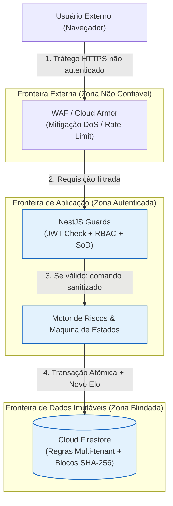

# Modelagem de Ameaças (STRIDE)

A segurança da informação e a conformidade contábil são pilares centrais do sistema **Alçadas**. Para mitigar riscos cibernéticos, fraudes financeiras e violações à **LGPD**, a arquitetura adota a metodologia **STRIDE** (*Spoofing*, *Tampering*, *Repudiation*, *Information Disclosure*, *Denial of Service* e *Elevation of Privilege*).

---

## 1. Visão Geral da Matriz STRIDE

| Categoria | Definição da Ameaça | Vetor no Sistema Alçadas | Mitigação Técnica / Controle Implementado | Requisito Associado |
| :--- | :--- | :--- | :--- | :--- |
| **Spoofing** (Falsificação de Identidade) | Um atacante se passa por um diretor para aprovar despesas indevidas. | Forjamento de tokens de autenticação ou interceptação de sessão. | Tokens JWT emitidos pelo **Firebase Auth**, validados criptograficamente pelo `FirebaseAuthGuard` via Firebase Admin SDK. | `RNF03` |
| **Tampering** (Adulteração de Dados) | Um usuário ou administrador com acesso direto ao banco altera o valor de uma despesa aprovada. | Edição de registros NoSQL diretamente nas coleções do Cloud Firestore. | **Cadeia Criptográfica SHA-256**: cada alteração gera um hash encadeado canônico. Se 1 byte for alterado no banco, o recálculo quebra e o auditor detecta em $< 1$ s. | `RF07`, `RF08`, `RNF02` |
| **Repudiation** (Repúdio) | Um aprovador nega ter autorizado um pagamento fraudulento. | Falta de rastreabilidade ou logs genéricos que não comprovem a autoria. | Cada elo da trilha grava `authorId`, `timestampUtc` de precisão em milissegundos, `ipOrigin` e o payload exato assinado digitalmente no bloco de auditoria. | `RF07`, `RF09`, `RNF02` |
| **Information Disclosure** (Vazamento de Informação) | Uma clínica/empresa visualiza dados financeiros ou pedidos de outro cliente. | Consultas NoSQL mal delimitadas ou logs expondo dados pessoais (PII). | **Isolamento Multi-tenant Lógico** com validação no `TenantGuard`, Security Rules no Firestore e interceptor que elimina 100% de PII dos logs (`RNF09`). | `RNF04`, `RNF07`, `RNF09` |
| **Denial of Service** (Negação de Serviço) | Múltiplas requisições simultâneas para corromper a máquina de estados ou travar aprovações. | Submissão de dezenas de decisões concorrentes para o mesmo pedido. | **Transações atômicas no Firestore** (`runTransaction`): exatamente uma obtém lock de escrita, enquanto as demais são recusadas com `HTTP 409 Conflict`. | `RF11`, `RN11` |
| **Elevation of Privilege** (Elevação de Privilégio) | Um colaborador submete um pedido e usa uma delegação de férias de um diretor para aprovar a própria compra. | Tentativa de burla da Segregação de Funções (*SoD*) via privilégios temporários. | **SoDGuard incondicional**: o sistema bloqueia (`HTTP 403`) qualquer tentativa de autoaprovação, ignorando delegações se `authorId == approverId`. | `RN03`, `RN12`, `RF12` |

---

## 2. Diagrama de Fluxo de Dados com Fronteiras de Confiança (DFD)

---

## 3. Conformidade com a LGPD e Retenção de Dados (`RNF04`, `RNF09`)

Para garantir atendimento integral à **Lei Geral de Proteção de Dados (Lei nº 13.709/2018)**:

1. **Princípio da Minimização:** Apenas são coletados o nome, e-mail institucional e IP do autor, exclusivamente para fins de auditoria contábil legal (base legal de cumprimento de obrigação regulatória e legítimo interesse).
2. **Higienização de Logs (`RNF09`):** Interceptors globais no NestJS filtram parâmetros sensíveis antes de qualquer envio ao Cloud Logging:
   - Parâmetros como `password`, `token`, `authorization`, `creditCard` e dados pessoais são substituídos por `[REDACTED]`.
3. **Prazo de Retenção e Descarte (`RNF04`):**
   - Dados financeiros e elos criptográficos são retidos por **5 anos após o encerramento do exercício contábil** correspondente, conforme legislação fiscal.
   - Após o prazo, uma rotina de expurgo anonimiza os dados do autor (`authorId` $\rightarrow$ `ANONYMIZED_USER`), mantendo intacta a integridade matemática da cadeia de hashes.
