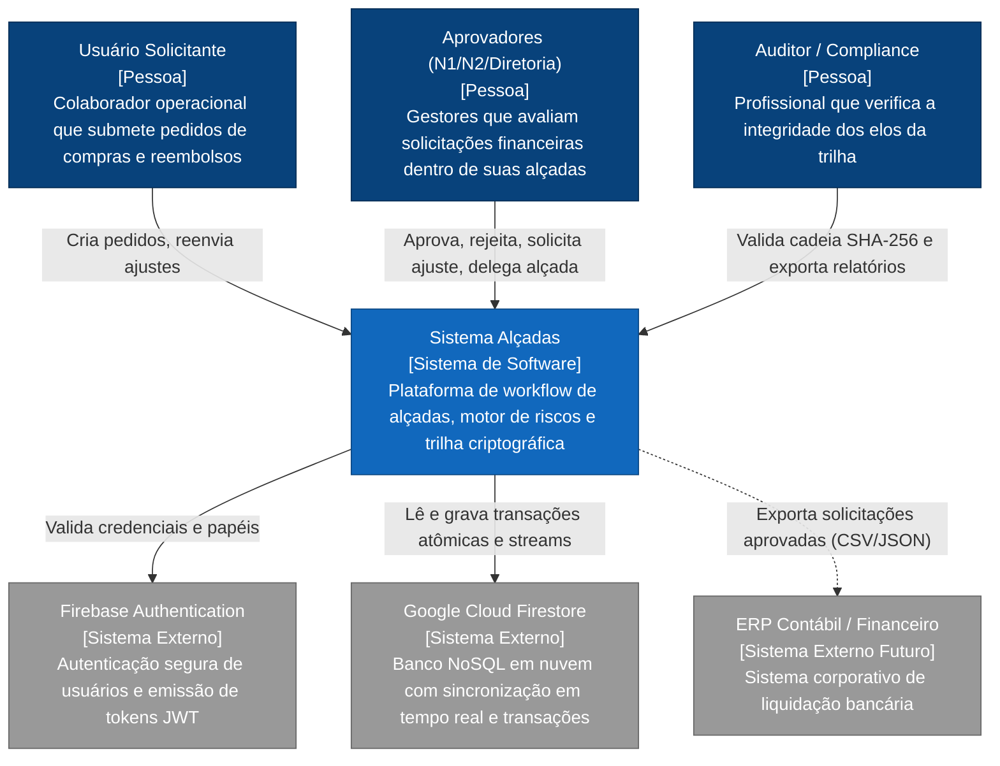
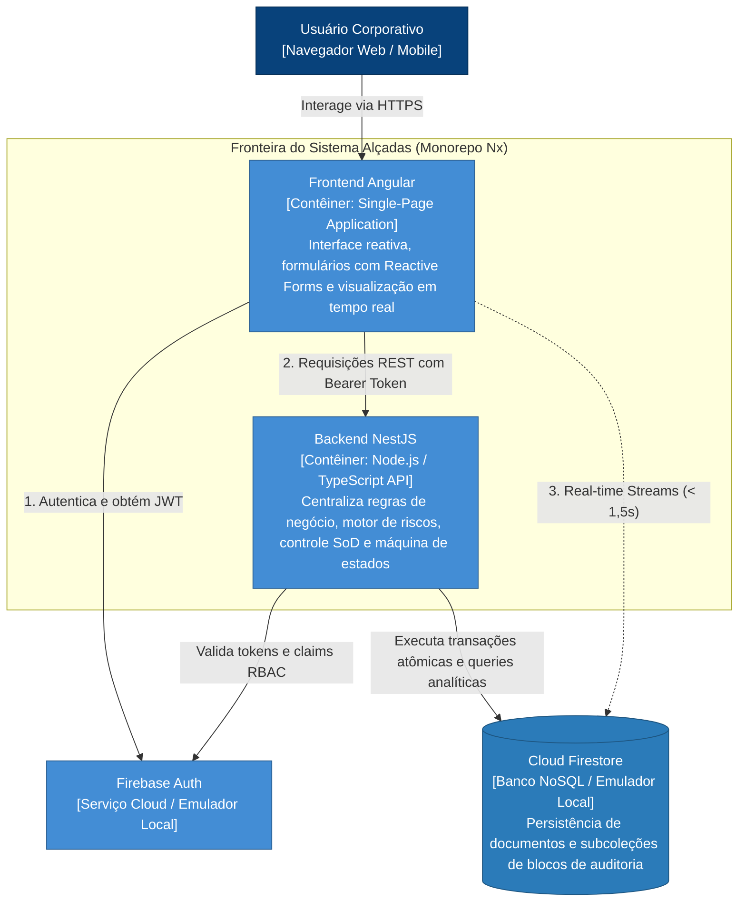
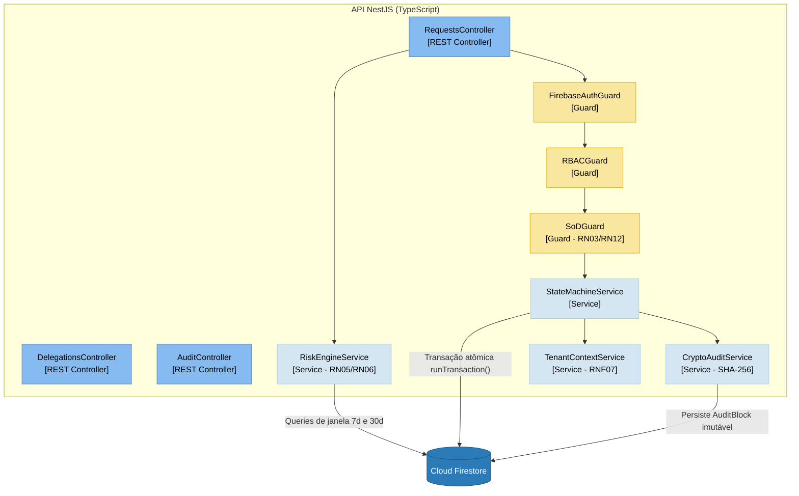
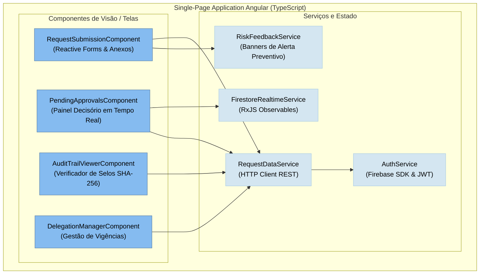

# Arquitetura C4 Model

O modelo **C4** (Contexto, Contêineres, Componentes e Código) fornece uma abordagem hierárquica e padronizada para visualizar a arquitetura de software do sistema **Alçadas**.

---

## 1. Nível 1: Diagrama de Contexto de Sistema (System Context)

Apresenta o sistema Alçadas no centro do ecossistema corporativo, seus diferentes perfis de usuários e as integrações externas:

---

## 2. Nível 2: Diagrama de Contêineres (Containers)

Evidencia a composição em nível de contêineres e aplicações executáveis:

---

## 3. Nível 3: Diagrama de Componentes (Backend NestJS)

Detalha os módulos, controladores, serviços e guards do **Backend NestJS**:

---

## 4. Nível 3: Diagrama de Componentes (Frontend Angular)

Detalha a arquitetura reativa do **Frontend Angular**:

