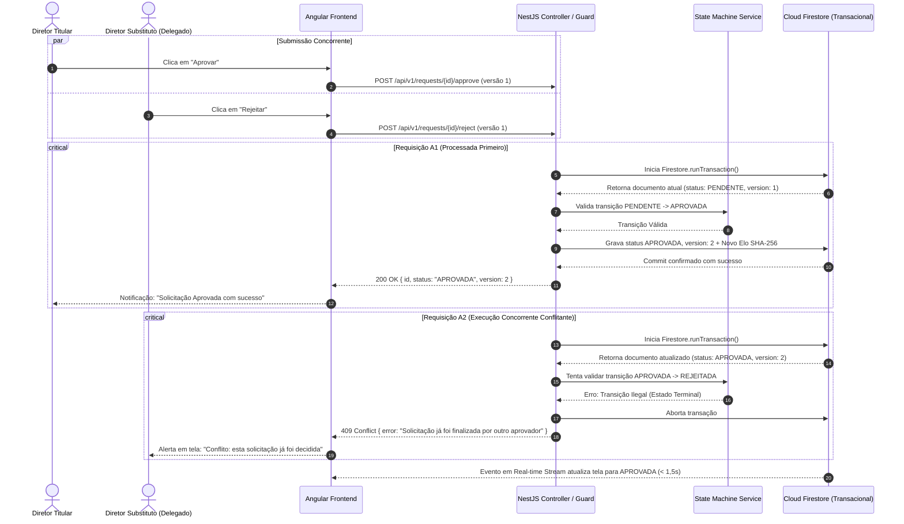
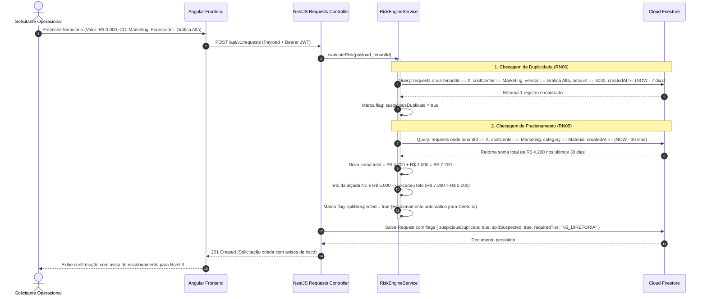
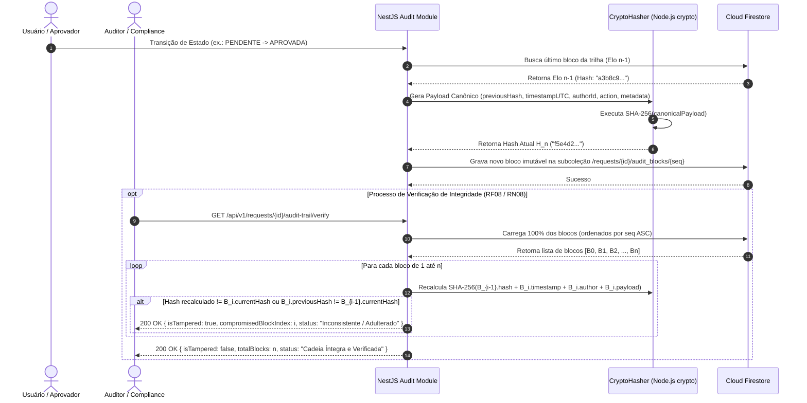
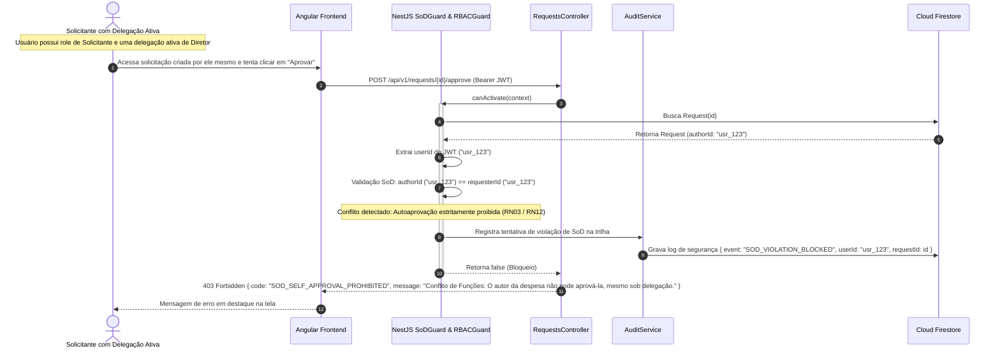

# Diagramas de Sequência UML

Esta página detalha as interações dinâmicas e síncronas/assíncronas entre os componentes do **Alçadas**, com foco nos quatro maiores desafios de engenharia do sistema:

1. **Tratamento de Decisões Concorrentes e Transações Atômicas (`RF11` / `RN11`)**
2. **Motor de Riscos: Prevenção de Fracionamento e Duplicidade (`RF05` / `RF06`)**
3. **Cadeia Criptográfica SHA-256 e Verificação de Integridade (`RF07` / `RF08`)**
4. **Segregação de Funções (*SoD*) em Delegações Temporárias (`RF04` / `RF12`)**

---

## 1. Concorrência e Transações Atômicas (HTTP 409 Conflict)

Quando dois aprovadores com competência sobre o mesmo pedido (ou o titular e seu delegado) submetem decisões simultâneas, o sistema utiliza a transação nativa do Firestore (`runTransaction`) para garantir controle otimista de concorrência:

---

## 2. Motor de Riscos: Anti-Fracionamento e Detecção de Duplicidade

Antes de disponibilizar a solicitação para a fila de aprovação regular, o **Motor de Riscos** processa consultas analíticas na base do *tenant*:

---

## 3. Cadeia Criptográfica SHA-256 e Verificação de Integridade

Fluxo de criação do selo criptográfico encadeado e o posterior recálculo de integridade pelo auditor:

---

## 4. Segregação de Funções (*SoD*) em Delegações Temporárias

Fluxo onde um usuário que recebeu delegação de um Diretor tenta aprovar um pedido de sua própria autoria:

