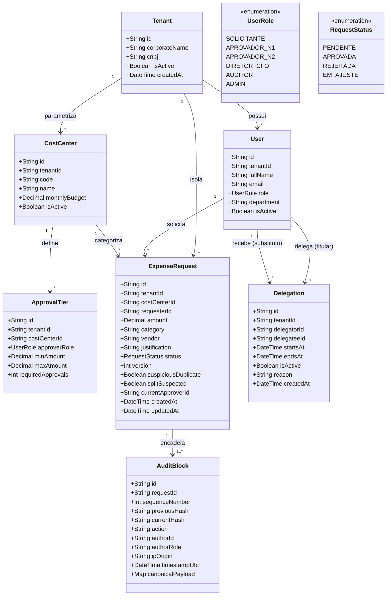

# Modelo de Dados e Classes de Domínio

Esta seção apresenta a modelagem estrutural do sistema **Alçadas**, englobando o **Diagrama de Classes de Domínio UML** e a especificação de documentos, coleções e índices compostos do **Google Cloud Firestore**.

---

## 1. Diagrama de Classes de Domínio (UML)

O modelo conceitual reflete as entidades de negócio, papéis de usuário, mecanismos de alçada e a imutabilidade da trilha de auditoria:



---

## 2. Modelagem Estrutural no Google Cloud Firestore

O Firestore armazena os dados sob o padrão **Multi-tenant com isolamento lógico** (`RNF07`). Coleções raízes representam tenants ou entidades de escopo corporativo, enquanto históricos imutáveis utilizam subcoleções.

### 2.1. Coleções Principais

```
firestore/
├── tenants/
│   └── {tenantId}/
│       ├── users/
│       │   └── {userId}
│       ├── cost_centers/
│       │   └── {costCenterId}
│       ├── approval_tiers/
│       │   └── {tierId}
│       ├── delegations/
│       │   └── {delegationId}
│       └── requests/
│           └── {requestId}/
│               └── audit_blocks/
│                   └── {blockSeq}
```

---

### 2.2. Esquema Detalhado dos Documentos

#### Coleção: `requests` (`/tenants/{tenantId}/requests/{requestId}`)

| Campo | Tipo | Descrição |
| :--- | :--- | :--- |
| `id` | `string (UUID v4)` | Identificador universal único do pedido. |
| `tenantId` | `string` | Identificador da empresa/clínica para isolamento lógico (`RNF07`). |
| `costCenterId` | `string` | ID do centro de custo associado. |
| `requesterId` | `string` | ID do usuário autor da solicitação (`RN03` - SoD). |
| `amount` | `number (float64)` | Valor financeiro da despesa em Reais (BRL). |
| `category` | `string` | Ex.: `"EQUIPAMENTOS"`, `"SERVICOS"`, `"VIAGENS"`. |
| `vendor` | `string` | Razão social ou CNPJ do fornecedor. |
| `justification` | `string` | Justificativa detalhada obrigatória se exceder faixa base (`RN02`). |
| `status` | `string` | `PENDENTE` \| `APROVADA` \| `REJEITADA` \| `EM_AJUSTE`. |
| `version` | `integer` | Contador atômico para controle de concorrência otimista (`RF11`). |
| `suspiciousDuplicate` | `boolean` | Flag gerada pelo Motor de Riscos para duplicidades em 7 dias (`RF06`). |
| `splitSuspected` | `boolean` | Flag gerada pelo Motor de Riscos para janela de 30 dias (`RF05`). |
| `lastDecisionReason` | `string?` | Motivo de ajuste ou rejeição (mínimo de 10 caracteres). |
| `createdAt` | `timestamp` | Carimbo UTC de criação. |
| `updatedAt` | `timestamp` | Carimbo UTC da última atualização. |

#### Subcoleção: `audit_blocks` (`.../requests/{requestId}/audit_blocks/{seq}`)

| Campo | Tipo | Descrição |
| :--- | :--- | :--- |
| `seq` | `integer` | Número sequencial (0 = Elo Gênese, 1, 2, ...). |
| `previousHash` | `string (hex SHA-256)` | Hash do elo imediatamente anterior ($H_{n-1}$). |
| `currentHash` | `string (hex SHA-256)` | Hash resultante deste elo ($H_n$). |
| `action` | `string` | `CRIADA` \| `AJUSTE_SOLICITADO` \| `REENVIADA` \| `APROVADA` \| `REJEITADA`. |
| `authorId` | `string` | ID do usuário que executou a ação. |
| `authorRole` | `string` | Cargo/papel no momento da execução. |
| `ipOrigin` | `string` | Endereço IP anonimizado para fins de auditoria forense. |
| `timestampUtc` | `string (ISO 8601)` | Timestamp com precisão de milissegundos. |
| `canonicalPayload` | `map` | Cópia imutável dos valores transacionados no momento da decisão. |

---

## 3. Índices Compostos Obrigatórios (Firestore)

Para assegurar resposta em tempo real ($< 1,5$ s conforme `RNF01`) nas consultas de risco e telas de listagem, são configurados os seguintes índices compostos:

```json
{
  "indexes": [
    {
      "collectionGroup": "requests",
      "queryScope": "COLLECTION",
      "fields": [
        { "fieldPath": "tenantId", "order": "ASCENDING" },
        { "fieldPath": "costCenterId", "order": "ASCENDING" },
        { "fieldPath": "vendor", "order": "ASCENDING" },
        { "fieldPath": "amount", "order": "ASCENDING" },
        { "fieldPath": "createdAt", "order": "DESCENDING" }
      ]
    },
    {
      "collectionGroup": "requests",
      "queryScope": "COLLECTION",
      "fields": [
        { "fieldPath": "tenantId", "order": "ASCENDING" },
        { "fieldPath": "costCenterId", "order": "ASCENDING" },
        { "fieldPath": "category", "order": "ASCENDING" },
        { "fieldPath": "createdAt", "order": "DESCENDING" }
      ]
    },
    {
      "collectionGroup": "audit_blocks",
      "queryScope": "COLLECTION",
      "fields": [
        { "fieldPath": "requestId", "order": "ASCENDING" },
        { "fieldPath": "seq", "order": "ASCENDING" }
      ]
    }
  ]
}
```
