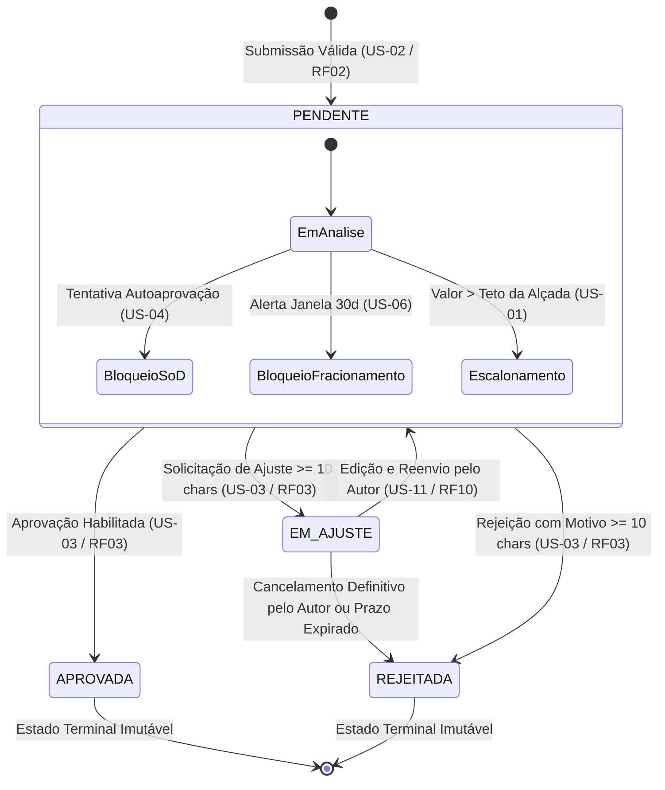

# Tabela de Transições da Máquina de Estados

Esta especificação define formalmente todas as transições de estado admissíveis no ciclo de vida de uma solicitação financeira no sistema **Alçadas**, em conformidade com o **Caderno B2B v2** (Checklist de Estória e Fluxo de Negócio) e o **Guia do Checkpoint 1**.

A modelagem assegura que **todo e qualquer caminho termina obrigatoriamente em um estado final** (`APROVADA` ou `REJEITADA`), inclusive os cenários de negação, bloqueio por Segregação de Funções (*SoD*) e tentativas fraudulentas.

---

## 1. Diagrama Geral de Ciclo de Vida e Decisão

---

## 2. Matriz Completa de Transições

A tabela a seguir detalha para cada transição: **Estado de Origem**, **Evento / Ação Requisitada**, **Condição de Guarda (Regras de Validação)**, **Papel Autorizado**, **Estado de Destino**, **Resposta HTTP** e o respectivo **Tipo de Log / Selo Criptográfico SHA-256** gravado na trilha de auditoria (conforme o catálogo [ADR-006](adrs/ADR-006-cadeia-de-hash.md)).

| # | Origem | Evento / Gatilho | Condição de Guarda | Papel Autorizado | Destino | Resposta HTTP | Log da Cadeia (SHA-256) |
| :-: | :--- | :--- | :--- | :--- | :--- | :---: | :--- |
| **T01** | `[*] (Inexistente)` | `SUBMETER` | Campos obrigatórios presentes; valor > 0; justificativa ≥ 30 chars se valor > base; tenant válido. | `SOLICITANTE` | `PENDENTE` | `201 Created` | **Log 1:** `CRIACAO_SOLICITACAO` |
| **T02** | `PENDENTE` | `APROVAR` | `valor <= tetoAlcada` E `autorId != aprovadorId` E `versao == versaoAtual`. | `USER_NORMAL` / `SUPER_USER` | `APROVADA` | `200 OK` | **Log 2:** `APROVACAO` |
| **T03** | `PENDENTE` | `REJEITAR` | Motivo de rejeição informado com tamanho ≥ 10 caracteres E `versao == versaoAtual`. | `USER_NORMAL` / `SUPER_USER` | `REJEITADA` | `200 OK` | **Log 3:** `REJEICAO` |
| **T04** | `PENDENTE` | `SOLICITAR_AJUSTE` | Motivo do ajuste informado com tamanho ≥ 10 caracteres E `versao == versaoAtual`. | `USER_NORMAL` / `SUPER_USER` | `EM_AJUSTE` | `200 OK` | **Log 4:** `PEDIDO_AJUSTE` |
| **T05** | `EM_AJUSTE` | `REENVIAR` | `autorId == usuarioLogado` E justificativa de ajuste informada E dados corrigidos. | `SOLICITANTE` | `PENDENTE` | `200 OK` | **Log 5:** `REENVIO_SOLICITACAO` |
| **T06** | `EM_AJUSTE` | `CANCELAR` | Desistência voluntária pelo autor ou ausência de correção no prazo. | `SOLICITANTE` | `REJEITADA` | `200 OK` | **Log 3:** `REJEICAO` (Desistência) |

---

## 3. Matriz de Negações, Bloqueios e Caminhos de Exceção

Toda tentativa de quebra de regra de governança ou concorrência é interceptada pelo backend, retornando erro estruturado e garantindo que o sistema não assuma estados inconsistentes:

| # | Origem | Ação Requisitada | Motivo do Bloqueio / Falha | Papel Infrator | Efeito no Estado | Resposta HTTP | Log da Cadeia / Auditoria |
| :-: | :--- | :--- | :--- | :--- | :--- | :---: | :--- |
| **N01** | `PENDENTE` | `APROVAR` | **Quebra de SoD:** Tentativa de autoaprovação (`autorId == aprovadorId`). | `SOLICITANTE` ou Delegado | Permanece `PENDENTE` | `403 Forbidden` | **Log 8:** `BLOQUEIO_SOD` |
| **N02** | `PENDENTE` | `APROVAR` | **Excesso de Alçada:** `valor > tetoAlcada` do cargo do aprovador. | `USER_NORMAL` | Permanece `PENDENTE` (Escalonamento) | `403 Forbidden` | Trilha de logs operacionais |
| **N03** | `PENDENTE` | `APROVAR` | **Suspeita de Fracionamento:** Soma de pedidos na janela de 30 dias > teto. | `USER_NORMAL` | Permanece `PENDENTE` (Trava preventiva) | `403 Forbidden` | **Log 9:** `BLOQUEIO_FRACIONAMENTO` |
| **N04** | `PENDENTE` | `APROVAR` / `REJEITAR` | **Colisão Concorrente:** `versao != versaoAtual` (outro aprovador decidiu antes). | Qualquer Aprovador | Permanece no estado atualizado | `409 Conflict` | Trilha de auditoria (Registro de colisão) |
| **N05** | `APROVADA` | `APROVAR` / `REJEITAR` | **Mutação em Estado Terminal:** Solicitação já decidida e arquivada. | Qualquer Papel | Permanece `APROVADA` | `409 Conflict` | Tentativa bloqueada |
| **N06** | `REJEITADA` | `APROVAR` / `REJEITAR` | **Mutação em Estado Terminal:** Solicitação já rejeitada e encerrada. | Qualquer Papel | Permanece `REJEITADA` | `409 Conflict` | Tentativa bloqueada |
| **N07** | `PENDENTE` | `REJEITAR` / `AJUSTE` | **Validação Falha:** Motivo com menos de 10 caracteres ou ausente. | Aprovador | Permanece `PENDENTE` | `400 Bad Request` | Não gera elo (Validação DTO) |
| **N08** | Qualquer | Qualquer Ação | **Isolamento de Tenant (`RNF07`):** Usuário da Empresa A acessando Empresa B. | Qualquer Papel | Nenhuma alteração | `403` ou `404` | Log de Segurança / Alerta |

---

## 4. Garantia de Encerramento em Estados Finais

Para cumprir o critério formal de que **todo caminho termina em estado final, inclusive a negação**:

1. **Caminho de Sucesso Primário:**  
   `[*] -> PENDENTE -> APROVADA -> [*]` (Fim);
2. **Caminho de Reprovação Primária:**  
   `[*] -> PENDENTE -> REJEITADA -> [*]` (Fim);
3. **Caminho de Ajuste com Sucesso:**  
   `[*] -> PENDENTE -> EM_AJUSTE -> PENDENTE -> APROVADA -> [*]` (Fim);
4. **Caminho de Ajuste com Desistência:**  
   `[*] -> PENDENTE -> EM_AJUSTE -> REJEITADA -> [*]` (Fim);
5. **Caminho de Negação por Alçada com Escalonamento:**  
   O `USER_NORMAL` recebe `HTTP 403` (ação negada). O pedido permanece `PENDENTE` na fila do escalão superior (`SUPER_USER`), até que seja decidido como `APROVADA` ou `REJEITADA`;
6. **Caminho de Negação por Violação de SoD ou Fraude:**  
   A tentativa de aprovação fraudulenta é rejeitada com `HTTP 403` e gravada no **Log 8**. O pedido é encaminhado ao Compliance/Administrador, que emite parecer sumário de `REJEITADA` com justificativa formal, encerrando o ciclo no estado terminal `REJEITADA`.
