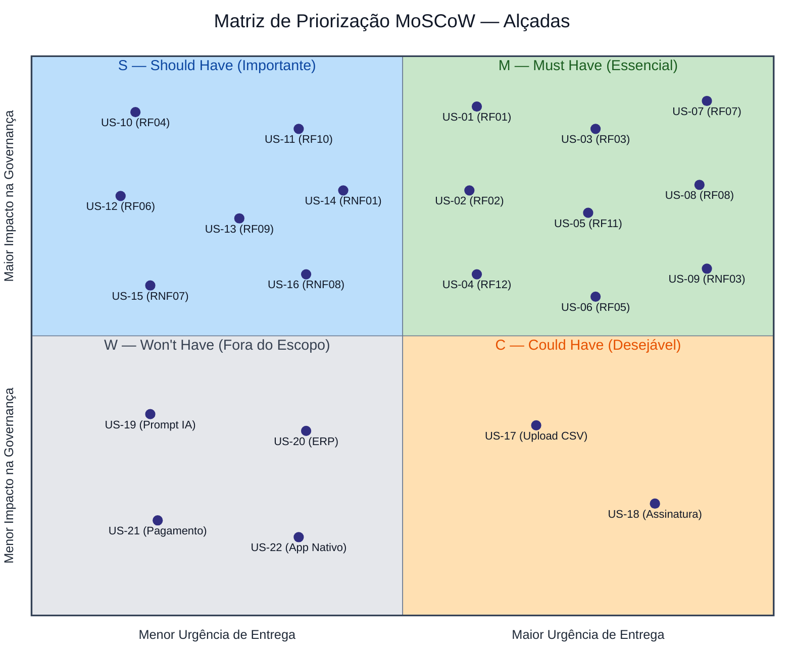

# Histórias de Usuários

As histórias seguem o formato **Como [papel], quero [ação], para [benefício]** e estão priorizadas pelo método **MoSCoW** (*Must, Should, Could, Won't*). Cada história possui critérios de aceite testáveis.

!!! note "Nota sobre Valores Propostos"
    Valores marcados com `(*)` foram propostos pela equipe e aguardam confirmação da cliente.

---

## Gráfico de 4 Quadrantes — Priorização MoSCoW

---

## 4.1. Must — Essencial para o MVP e o Demo Day

| ID / Origem | História | Critérios de Aceite |
| :--- | :--- | :--- |
| **US-01** `RF01`, `RN01` · `OE1` · Jornada 1 | **Configurar centros de custo e alçadas** Como **Administrador**, quero cadastrar centros de custo e definir o teto financeiro de aprovação de cada cargo/nível hierárquico, para que toda aprovação tenha um limite máximo definido e verificável. | **CA-01.1** Salvar uma faixa de alçada com teto vazio, 0 ou negativo é recusado com mensagem de erro em 100% dos casos; 0 faixas inválidas persistidas.  **CA-01.2** Com teto do cargo Gerente = R$ 5.000,00, um pedido de R$ 5.000,01 não pode ser decidido pelo Gerente (`HTTP 403`) e fica disponível ao nível superior.  **CA-01.3** Um centro de custo recém-criado aparece na lista de seleção do formulário de solicitação em até 1,5 s `(*)` sem recarregar a página. |
| **US-02** `RF02`, `RN02` · `OE1` · Jornada 2 | **Criar solicitação de compra, pagamento ou reembolso** Como **Solicitante** (gestor de clínica ou obra), quero registrar um pedido de compra, pagamento ou reembolso informando centro de custo, valor, categoria e justificativa, para que ele entre formalmente na fila de aprovação em vez de circular por mensagem ou planilha. | **CA-02.1** Enviar sem qualquer um dos 4 campos obrigatórios (centro de custo, valor, categoria, justificativa) é bloqueado; 0 solicitações criadas e o campo faltante é indicado.  **CA-02.2** Valor acima da faixa base da categoria exige justificativa com no mínimo 30 caracteres `(*)`; com 29 caracteres o envio é recusado, com 30 é aceito.  **CA-02.3** Valor ≤ 0 ou com mais de 2 casas decimais é recusado em 100% dos casos.  **CA-02.4** Após o envio válido, a solicitação existe com status `PENDENTE` e o solicitante a vê na sua lista em até 1,5 s. |
| **US-03** `RF03` · `OE4` · Jornada 3 | **Aprovar, rejeitar ou pedir ajuste dentro da minha alçada** Como **Aprovador/Diretor**, quero aprovar, rejeitar ou solicitar ajustes em pedidos dentro da minha faixa de valor, para decidir com autoridade formal e sem depender de e-mail. | **CA-03.1** Pedido com valor acima do teto do aprovador: tentativa de decisão retorna `HTTP 403` em 100% dos casos; status não muda.  **CA-03.2** Rejeitar ou pedir ajuste exige motivo de no mínimo 10 caracteres `(*)`; com 9 a ação é recusada.  **CA-03.3** Cada decisão leva a solicitação, respectivamente, para `APROVADA`, `REJEITADA` ou `EM_AJUSTE` e grava o ID do autor; 1 decisão = 1 transição.  **CA-03.4** Uma solicitação já `APROVADA` ou `REJEITADA` não aceita nova decisão (`HTTP 409`). |
| **US-04** `RF12`, `RN03`, `RN12` · `OE1` · Jornada 4 | **Impedir que o solicitante aprove o próprio pedido (SoD)** Como **Controller/CFO**, quero que ninguém possa aprovar uma solicitação que ele mesmo criou, nem como titular nem como substituto delegado, para garantir a segregação de funções exigida em auditoria. | **CA-04.1** Solicitante tentando aprovar o próprio pedido recebe `HTTP 403` em 100% das tentativas.  **CA-04.2** Substituto com delegação ativa tentando aprovar pedido criado por ele mesmo recebe `HTTP 403` (`RN12`); 0 aprovações registradas.  **CA-04.3** Cada bloqueio gera 1 registro na trilha com ID do usuário e motivo `SOD`. |
| **US-05** `RF11`, `RN11` · `OE4` · Desafio de Engenharia | **Evitar decisões simultâneas conflitantes** Como **Aprovador**, quero que o sistema aceite só uma decisão quando eu e outra pessoa (outro aprovador ou o titular/delegado) decidimos o mesmo pedido ao mesmo tempo, para que o estado final seja único e consistente. | **CA-05.1** Duas requisições de decisão simultâneas sobre a mesma solicitação e mesma versão: exatamente 1 retorna sucesso e 1 retorna `HTTP 409 Conflict`.  **CA-05.2** Em 100 pares concorrentes automatizados `(*)`, 0 casos terminam com duas decisões gravadas ou com o status divergindo do último elo da trilha.  **CA-05.3** Requisição enviada com versão desatualizada é recusada com `HTTP 409` e não altera o estado. |
| **US-06** `RF05`, `RN05` · `OE2` · Jornada 4 | **Bloquear fracionamento de compras** Como **Controller/CFO**, quero que o sistema bloqueie e escale pedidos que, somados na janela de 30 dias, passem do teto da alçada, para impedir que compras sejam divididas para fugir da aprovação da diretoria. | **CA-06.1** Mesmo centro de custo e categoria, teto da alçada inferior R$ 5.000,00, pedido anterior de R$ 2.000,00 há 10 dias e novo pedido de R$ 4.900,00 (soma R$ 6.900,00): o novo pedido é bloqueado e escalonado ao nível superior.  **CA-06.2** Mesma situação com o pedido anterior há 31 dias: nenhum bloqueio (janela móvel de 30 dias).  **CA-06.3** Soma exatamente igual ao teto (R$ 5.000,00) não bloqueia; soma de R$ 5.000,01 bloqueia.  **CA-06.4** Na massa de testes do Demo Day, 100% dos casos de fracionamento são detectados, cada um em menos de 1 s. |
| **US-07** `RF07`, `RN07`, `RNF02` · `OE3` · Jornada 5 | **Gerar selo de auditoria encadeado a cada mudança** Como **Auditor**, quero que toda mudança de estado de uma solicitação gere um registro imutável com *hash* SHA-256 encadeado ao anterior, para ter uma trilha em que nenhum evento passado possa ser alterado sem deixar rastro. | **CA-07.1** 100% das transições de estado geram exatamente 1 elo; o *hash* $H_n$ é SHA-256 de $H_{n-1}$ + *timestamp* UTC + ID do autor + *payload* da ação (`RN07`).  **CA-07.2** O primeiro elo de cada solicitação usa um *hash* gênese fixo e documentado.  **CA-07.3** Qualquer tentativa de editar ou apagar um elo pela API (incluindo com usuário Administrador) retorna `HTTP 403` ou `405`; 0 elos modificados.  **CA-07.4** Duas execuções do cálculo com a mesma entrada produzem o mesmo *hash* (teste determinístico). |
| **US-08** `RF08`, `RN08`, `RNF02` · `OE3` · Demo Day | **Verificar a integridade da trilha e destacar adulterações** Como **Auditor**, quero recalcular a cadeia de *hashes* de uma solicitação e ver destacado qualquer registro adulterado, para provar numa fiscalização que o histórico é confiável. | **CA-08.1** Cadeia íntegra de até 1.000 elos `(*)` é verificada em menos de 1 s e exibe `"Íntegra"`.  **CA-08.2** Alterar 1 byte de um registro direto no banco faz o recálculo apontar o primeiro elo quebrado e marcá-lo como `"Inconsistente / Adulterado"` (`RN08`).  **CA-08.3** Em todos os casos de adulteração da massa de testes (alterar, apagar e inserir elo), a detecção é de 100%, em menos de 1 s.  **CA-08.4** Só o perfil Auditor acessa a verificação; outros perfis recebem `HTTP 403`. |
| **US-09** `RNF03` · `OE1` | **Controle de acesso por papel em toda operação crítica** Como **Administrador**, quero que cada operação crítica valide o papel e a competência do usuário na hora da chamada, para que ninguém execute ações fora do seu perfil. | **CA-09.1** 100% das tentativas de aprovação fora da competência configurada retornam `HTTP 403`.  **CA-09.2** Requisição sem token JWT válido retorna `HTTP 401`; com token expirado, também `401`.  **CA-09.3** Um teste automatizado percorre todas as rotas críticas (criar, decidir, delegar, exportar, verificar) e confirma que 0 rotas respondem `2xx` sem a permissão adequada.  **CA-09.4** Um usuário com papel Solicitante recebe `HTTP 403` ao abrir o módulo de auditoria sobre o próprio pedido. |

---

## 4.2. Should — Importante, entra se o prazo permitir

| ID / Origem | História | Critérios de Aceite |
| :--- | :--- | :--- |
| **US-10** `RF04`, `RN04` · `OE4` · Jornada 3 | **Delegar minha alçada durante ausências** Como **Aprovador/Diretor**, quero transferir temporariamente minha competência de aprovação a um substituto habilitado, com data de início e fim, para que pedidos não fiquem parados quando estou ausente.  *Por que Should:* é um diferencial do produto (diretor em férias não trava compras), mas o fluxo básico de decisão funciona sem ele. | **CA-11.1** Criar delegação sem data de início ou de término é recusado em 100% dos casos; término anterior ao início também.  **CA-11.2** A delegação deixa de valer automaticamente no instante do término: uma aprovação feita 1 s depois do fim retorna `HTTP 403`.  **CA-11.3** Durante a vigência, o substituto aprova pedidos até o teto do delegante; acima desse valor, `HTTP 403`.  **CA-11.4** Criar e expirar a delegação geram 2 elos na trilha de auditoria. |
| **US-11** `RF10`, `RN10` · Jornada 3 | **Corrigir e reenviar uma solicitação em ajuste** Como **Solicitante**, quero editar dados e anexos de um pedido marcado como `"Em Ajuste"` e reenviá-lo, para resolver a pendência sem abrir um pedido novo.  *Por que Should:* o status `EM_AJUSTE` nasce na `US-03`; sem esta história ele vira beco sem saída, então deve ser feita logo depois da `US-03`. | **CA-12.1** Edição de pedido em qualquer status diferente de `EM_AJUSTE` retorna `HTTP 409` em 100% dos casos.  **CA-12.2** O reenvio devolve o status para `PENDENTE` e gera exatamente 1 novo elo na trilha.  **CA-12.3** Só o autor original pode editar; outro usuário recebe `HTTP 403`.  **CA-12.4** Anexos aceitos até 5 MB cada e 3 arquivos por pedido `(*)`; acima disso o envio é recusado. |
| **US-12** `RF06`, `RN06` · `OE2` · Jornada 4 | **Sinalizar lançamentos duplicados** Como **analista do Setor Financeiro**, quero ser alertado quando entra um pedido idêntico a outro recente, para evitar pagar duas vezes a mesma despesa. | **CA-13.1** Pedido com mesmo valor, centro de custo e fornecedor de outro criado há menos de 7 dias é sinalizado como `"Suspeita de duplicidade"`.  **CA-13.2** Com intervalo de 7 dias ou mais, ou com diferença de R$ 0,01 no valor, não há sinalização.  **CA-13.3** O alerta aparece no painel do aprovador em até 1,5 s após a criação e não bloqueia a decisão (só sinaliza). |
| **US-13** `RF09`, `RN09` · Jornada 5 | **Exportar relatório de conformidade** Como **Auditor/Controladoria**, quero exportar o ciclo de vida completo de uma solicitação com seus selos digitais em CSV ou JSON, para validar a cadeia fora do sistema e anexar a processos de auditoria. | **CA-14.1** O arquivo exportado contém 100% dos elos da solicitação, cada um com seu *hash* e o *hash* anterior.  **CA-14.2** O arquivo traz o carimbo de data/hora UTC da extração (1 campo, formato ISO 8601).  **CA-14.3** Recalcular os *hashes* a partir do arquivo exportado, fora do sistema, reproduz 100% dos *hashes* originais.  **CA-14.4** Exportação de uma solicitação com até 1.000 elos `(*)` termina em até 5 s `(*)`. |
| **US-14** `RNF01` · `OE4` | **Ver mudanças de status sem recarregar a página** Como **Solicitante ou Aprovador**, quero que meu painel atualize sozinho quando um pedido muda de status ou surge um alerta, para acompanhar o andamento em tempo real. | **CA-15.1** Uma mudança de status chega a todos os painéis abertos em menos de 1,5 s.  **CA-15.2** Com 10 painéis abertos simultaneamente `(*)`, 100% recebem a atualização dentro desse limite.  **CA-15.3** A atualização acontece sem recarregar a página (0 recarregamentos nos testes e2e). |
| **US-15** `RNF07` | **Isolar dados entre empresas** Como **usuário de uma clínica ou construtora**, quero que ninguém de outra organização veja ou altere meus registros, para proteger os dados financeiros da minha empresa.  *Por que Should:* é obrigatório assim que houver mais de uma clínica/franquia no mesmo ambiente; no piloto com uma única organização o risco é menor. | **CA-16.1** Em 100% dos testes automatizados de acesso cruzado entre *tenants*, a resposta é `HTTP 403` ou `404`.  **CA-16.2** Nenhuma listagem retorna registros de outro *tenant*: 0 itens estranhos em consultas com 2 *tenants* populados.  **CA-16.3** A verificação de *hashes* de um *tenant* nunca lê elos de outro. |
| **US-16** `RNF08` | **Ver estados de carregamento, vazio e erro em todas as telas** Como **usuário do sistema**, quero ver feedback claro enquanto a tela carrega, quando não há dados e quando algo falha, para não achar que o sistema travou.  *Por que Should:* está no *DoD*, mas não muda regra de negócio. | **CA-17.1** 100% das telas das 5 jornadas do MVP implementam os 3 estados (*loading*, *empty*, *error*).  **CA-17.2** O indicador de *loading* aparece quando a resposta demora mais de 300 ms `(*)`.  **CA-17.3** Em erro de API (`HTTP 5xx` simulado), a tela mostra mensagem e botão `"Tentar novamente"` em 100% das telas. |

---

## 4.3. Could — Desejável, sem impacto se ficar de fora

| ID / Origem | História | Critérios de Aceite |
| :--- | :--- | :--- |
| **US-17** Ideia da seção 4 do documento (*"registro por upload modelo de texto"*) | **Registrar solicitações por upload de arquivo de texto** Como **Solicitante**, quero enviar um arquivo de texto padronizado com os dados do pedido, para cadastrar vários pedidos sem preencher o formulário um a um. | **CA-21.1** Arquivo `.csv` com 20 linhas válidas `(*)` cria 20 solicitações `PENDENTE`, cada uma passando pelas mesmas validações da `US-02`.  **CA-21.2** Linha inválida é rejeitada com número da linha e motivo; as demais linhas são processadas; 0 linhas inválidas gravadas.  **CA-21.3** Arquivo acima de 1 MB ou com mais de 200 linhas `(*)` é recusado por inteiro. |
| **US-18** Ideia da seção 4 do documento (*"registro de assinatura do administrador para aprovar comprovante da solicitação"*). **Interpretação a confirmar com a cliente:** o administrador anexa e assina digitalmente o comprovante antes da aprovação. | **Registrar a assinatura do administrador no comprovante** Como **Administrador**, quero registrar minha assinatura sobre o comprovante de uma solicitação, para que a trilha mostre quem validou o documento. | **CA-22.1** A assinatura gera 1 elo na trilha com ID do administrador, *timestamp* UTC e *hash* do arquivo (SHA-256).  **CA-22.2** Alterar 1 byte do comprovante depois da assinatura faz a verificação marcar o documento como `"Inconsistente / Adulterado"`.  **CA-22.3** Só o papel Administrador assina; outros papéis recebem `HTTP 403`. |

---

## 4.4. Won't — Decidimos não fazer nesta entrega de 9 semanas

| ID / Origem | História | Critérios de Aceite |
| :--- | :--- | :--- |
| **US-19** Ideia da seção 4 do documento (*"registro por prompt"*) | **Registrar solicitações por prompt (linguagem natural / IA)** Como **Solicitante**, quero descrever o pedido em texto livre e ter os campos preenchidos automaticamente, para registrar mais rápido.  **Motivo:** exige modelo de linguagem, validação de saída e custo variável; o teto de nuvem é US$ 50,00 e o prazo é 9 semanas. As outras duas formas de registro (formulário e upload) cobrem a jornada 2.  **Reavaliar quando:** o MVP estiver em produção e o formulário for apontado como gargalo. | **CA-23.1** Na release do MVP existem 0 rotas de API e 0 telas de entrada em linguagem natural.  **CA-23.2** Gasto com serviços de IA no ciclo = US$ 0,00. |
| **US-20** | **Integrar com ERP (ex.: TOTVS)** Como **analista do Setor Financeiro**, quero que pedidos aprovados sigam automaticamente para o ERP, para não relançar o mesmo dado à mão.  **Motivo:** o produto se posiciona como camada leve de governança, não como substituto de ERP; integração exige contrato com fornecedor e homologação fora do prazo.  **Reavaliar quando:** a Startop LTDA definir um ERP-alvo e fornecer ambiente de testes. | **CA-24.1** O MVP contém 0 conectores ou chamadas de saída para sistemas ERP.  **CA-24.2** A exportação CSV/JSON da `US-13` (`US-14` na referência original) é o único meio de saída de dados e passa nos critérios dela. |
| **US-21** | **Executar o pagamento e conciliar com o banco** Como **analista do Setor Financeiro**, quero disparar o pagamento da solicitação aprovada e conciliar com o extrato, para fechar o ciclo no mesmo sistema.  **Motivo:** o Alçadas decide se uma despesa pode ser feita, não paga nem concilia; envolver dinheiro real traria requisitos de segurança e regulatórios fora do escopo.  **Reavaliar quando:** governança de alçadas estiver validada e a Startop pedir fechamento do ciclo de pagamento. | **CA-25.1** O MVP não possui o status `PAGA` nem rota de pagamento: 0 transições para fora de `APROVADA`/`REJEITADA`/`EM_AJUSTE`/`PENDENTE`.  **CA-25.2** O sistema não armazena número de cartão nem de conta bancária: 0 campos desse tipo no modelo de dados. |
| **US-22** | **Aplicativo móvel nativo** Como **Aprovador/Diretor**, quero aprovar pedidos por um aplicativo no celular, para decidir em deslocamento.  **Motivo:** o front-end é Angular web; os painéis em tempo real funcionam em navegador de celular e um app nativo dobraria o esforço de teste.  **Reavaliar quando:** pesquisa com aprovadores mostrar necessidade de aprovar fora do navegador. | **CA-26.1** O repositório da entrega contém 0 projetos mobile nativos (Android/iOS).  **CA-26.2** As telas de decisão (`US-03`) funcionam em navegador com largura de 360 px sem rolagem horizontal `(*)`. |
