# Modelagem BPMN — Processo Atual (As-Is)

Esta seção documenta a modelagem formal de processos de negócio (**BPMN 2.0**) do cenário operacional prévio da **Startop LTDA**, caracterizado por fluxos informais, descentralizados e com ausência de controles automatizados de alçadas e auditoria.

---

## 1. Contexto e Dores do Processo As-Is

O processo operacional anterior apoiava-se primariamente em mensagens instantâneas (**WhatsApp**), trocas de **e-mails** não padronizadas e controle retroativo em **planilhas eletrônicas**. Esse formato gerava vulnerabilidades severas:

- **Aprovações Tácitas e Informais:** Decisões sem registro formal de horário, justificativa ou versão do pedido;
- **Ausência de Segregação de Funções (SoD):** Gestores aprovando pedidos por eles mesmos submetidos ou aprovadores ultrapassando limites tácitos de orçamento;
- **Vulnerabilidade a Fracionamento e Duplicidade:** Compras divididas em múltiplos pedidos de valor menor para evitar aprovação de diretores, além de pagamentos repetidos para o mesmo fornecedor;
- **Insegurança Contábil e Risco de Fraude:** Trilha de auditoria inexistente ou passível de adulteração posterior em planilhas sem proteção criptográfica.

---

## 2. Diagrama de Processo BPMN 2.0 (As-Is)

```mermaid
flowchart TD
    classDef startEnd fill:#d4edda,stroke:#28a745,stroke-width:2px;
    classDef task fill:#e2e3e5,stroke:#383d41,stroke-width:1.5px;
    classDef painTask fill:#f8d7da,stroke:#dc3545,stroke-width:2px;
    classDef gateway fill:#fff3cd,stroke:#ffc107,stroke-width:2px;

    subgraph Pool["Processo Atual de Solicitação e Pagamento (As-Is) — Startop LTDA"]
        subgraph Solicitante["Raia: Solicitante Operacional"]
            Start(["Necessidade de Compra / Reembolso"]):::startEnd
            T1["Cria pedido informal via WhatsApp ou E-mail"]:::task
            T_Ajuste["Reenvia comprovante ou retifica valor informalmente"]:::task
        end

        subgraph Gestor["Raia: Gestor Imediato"]
            G1{"Pedido possui clareza?"}:::gateway
            T2["Avalia mensagem e emite 'OK' informal"]:::painTask
        end

        subgraph Diretoria["Raia: Diretoria / CFO"]
            G2{"Valor alto ou extrapola orçamento?"}:::gateway
            T3["Recebe encaminhamento solto e responde aprovação"]:::painTask
            T_Gargalo["Aprovação represada por ausência ou viagem"]:::painTask
        end

        subgraph Financeiro["Raia: Financeiro / Contas a Pagar"]
            T4["Recebe 'print' de aprovação e lança manualmente"]:::painTask
            G3{"Há suspeita de duplicidade / fracionamento?"}:::gateway
            T5["Efetua liquidação/pagamento bancário"]:::task
            T6["Registra pagamento em planilha Excel compartilhada"]:::painTask
            End(["Pagamento Efetuado sem Trilha Criptográfica"]):::startEnd
        end
    end

    Start --> T1
    T1 --> G1
    G1 -- "Não (Faltam dados)" --> T_Ajuste
    T_Ajuste --> G1
    G1 -- "Sim" --> T2
    T2 --> G2
    G2 -- "Sim (> R$ 5.000 ou sensível)" --> T_Gargalo
    T_Gargalo --> T3
    G2 -- "Não" --> T4
    T3 --> T4
    T4 --> G3
    G3 -- "Sim (Identificação visual falha)" --> T5
    G3 -- "Não (Passa despercebido)" --> T5
    T5 --> T6
    T6 --> End
```

---

## 3. Matriz de Gargalos e Pontos de Falha Operacional

| Etapa As-Is | Ator Envolvido | Falha / Risco Crítico Identificado | Requisito Alçadas Relacionado |
| :--- | :--- | :--- | :--- |
| **Envio de Pedido** | Solicitante | Ausência de campos obrigatórios, falta de categorização orçamentária e ausência de centro de custo. | `RF02`, `RN02` |
| **Aprovação Imediata** | Gestor | Ocorrência de autoaprovação de despesas pessoais sem bloqueio de sistema (*Violação de SoD*). | `RF03`, `RN03` (SoD) |
| **Aprovação de Diretoria** | Diretor / CFO | Parada de fluxo quando o titular se ausenta; ausência de mecanismo de delegação temporária auditável. | `RF04`, `RN04` |
| **Triagem Financeira** | Financeiro | Inexistência de motor automatizado para somar janelas móveis de 30 dias (fracionamento) ou 7 dias (duplicidade). | `RF05`, `RF06`, `RN05`, `RN06` |
| **Registro em Planilha** | Financeiro / Auditoria | Histórico vulnerável a exclusões acidentais, edições retroativas e ausência de comprovação de autoria. | `RF07`, `RF08`, `RNF02` |
