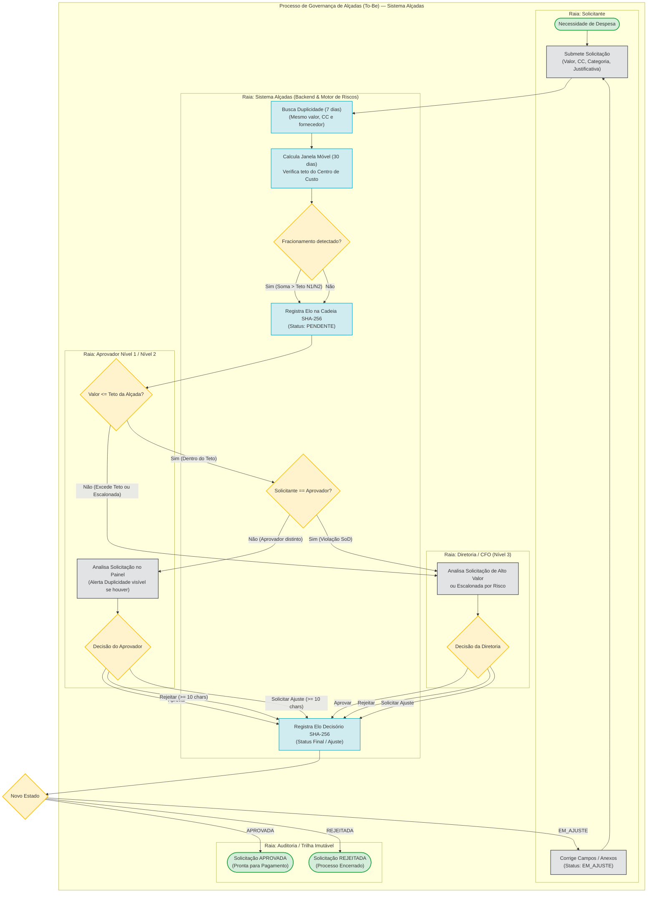
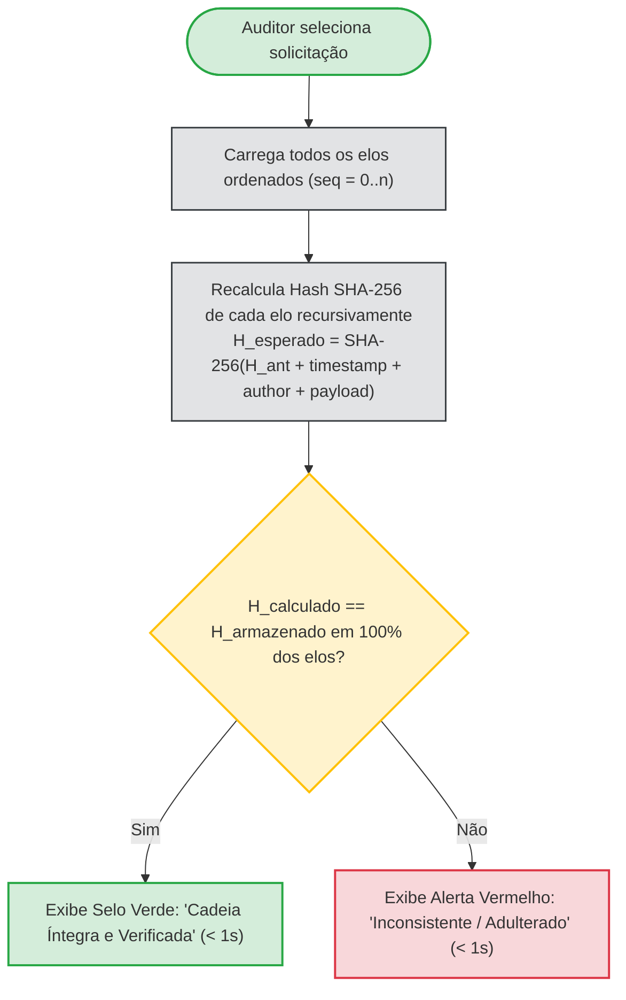

# Modelagem BPMN — Processo Proposto (To-Be)

Esta seção especifica a modelagem formal de processos de negócio (**BPMN 2.0**) do sistema **Alçadas**. O fluxo substitui as comunicações informais por uma esteira padronizada, orquestrada por regras de governança, segregação de funções (*SoD*), alertas preditivos de risco e auditoria criptográfica.

---

## 1. Fluxo Principal de Submissão, Análise e Decisão

O processo orquestra a interação entre o **Solicitante**, o **Motor de Riscos e Regras**, os **Aprovadores Hierárquicos** e a **Trilha de Auditoria**.

---

## 2. Subprocesso BPMN: Delegação Temporária e Expiração por Timer

Para atender aos requisitos `RF04` e `RN04`, o sistema implementa um subprocesso com evento de fronteira de temporização (*Boundary Timer Event*):

```mermaid
flowchart LR
    classDef startEnd fill:#d4edda,stroke:#28a745,stroke-width:2px;
    classDef task fill:#e2e3e5,stroke:#383d41,stroke-width:1.5px;
    classDef serviceTask fill:#d1ecf1,stroke:#17a2b8,stroke-width:1.5px;
    classDef timer fill:#fff3cd,stroke:#ffc107,stroke-width:2px;

    StartDel(["Aprovador Titular Ausente"]):::startEnd
    T_ConfigDel["Parametriza Substituto,\nInício e Fim da Vigência"]:::task
    T_GravaDel["Grava Delegação + Elo SHA-256"]:::serviceTask
    T_Ativa["Delegação Vigente:\nSubstituto atua na alçada delegada\n(Blindado por SoD: RN12)"]:::task
    Timer["Timer: Data/Hora Fim Atingida"]:::timer
    T_Expira["Sistema revoga acesso substituto automaticamente\n+ Grava Elo SHA-256 de Expiração"]:::serviceTask
    EndDel(["Delegação Finalizada"]):::startEnd

    StartDel --> T_ConfigDel --> T_GravaDel --> T_Ativa
    T_Ativa --> Timer --> T_Expira --> EndDel
```

---

## 3. Subprocesso BPMN: Verificação de Integridade Criptográfica

Para atender aos requisitos `RF08` e `RN08`, a controladoria e auditores contam com o fluxo de checagem em tempo de execução:

---

## 4. Comparativo de Ganhos: As-Is vs. To-Be

| Dimensão | Processo As-Is (Startop LTDA) | Processo To-Be (Sistema Alçadas) |
| :--- | :--- | :--- |
| **Canal de Entrada** | Mensagens dispersas (WhatsApp/E-mail) | Formulário web tipado com validação de campos obrigatórios (`RF02`) |
| **Controle de Alçadas** | Informal e dependente da memória dos gestores | Parametrizado por Centro de Custo com limites matemáticos rígidos (`RF01`, `RN01`) |
| **Mitigação de Riscos** | Zero detecção de fracionamento ou duplicidade | Motor de riscos atuando em janelas móveis de 30 dias e 7 dias (`RF05`, `RF06`) |
| **Segregação de Funções** | Frequente autoaprovação de despesas | Bloqueio automático de autoaprovação via Guard (`RN03`, `RN12`) |
| **Auditoria e Evidências** | Planilhas editáveis sem controle de versão | Encadeamento criptográfico SHA-256 imutável à prova de adulteração (`RF07`, `RF08`) |
| **Tempo de Notificação** | Horas ou dias aguardando retorno | Sincronização em tempo real via streams em $< 1,5$ s (`RNF01`) |
