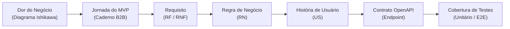

# Matriz de Rastreabilidade Bidirecional

A rastreabilidade bidirecional (*Forward & Backward Traceability*) garante que toda funcionalidade do sistema **Alçadas** decorre diretamente de uma dor comprovada da cliente (**Startop LTDA**) e que cada linha de código/endpoint possui requisitos, regras de negócio e testes associados.

---

## 1. Visão Geral da Rastreabilidade de Ponta a Ponta

---

## 2. Matriz Integrada de Rastreabilidade

| Dor Original (Ishikawa) | Jornada MVP | Requisito Funcional | Regra de Negócio | História de Usuário (US) | Endpoint OpenAPI v0.2 | Casos de Teste (CT) |
| :--- | :--- | :--- | :--- | :--- | :--- | :--- |
| Ausência de limites claros de aprovação por cargo | Jornada 1: Configuração | **RF01** | **RN01** (Tetos por nível) | **US-01** (Configurar Alçadas) | `POST /api/centros-custo` `PUT /api/alcadas/tetos` | CT-01, CT-08, CT-09 |
| Pedidos soltos em mensagens de WhatsApp | Jornada 2: Submissão | **RF02** | **RN02** (Justificativa obrigatória) | **US-02** (Submeter Pedido) | `POST /api/solicitacoes` | CT-02, CT-03, CT-10, CT-11 |
| Decisão sem autoridade formal | Jornada 3: Decisão | **RF03** | **RN01** (Tetos por nível) | **US-03** (Decidir dentro da alçada) | `POST /api/solicitacoes/{id}/aprovar` `POST /api/solicitacoes/{id}/rejeitar` `POST /api/solicitacoes/{id}/ajuste` | CT-04, CT-06, CT-12, CT-13 |
| Autoaprovação indevida de despesas pessoais | Jornada 3: Decisão & SoD | **RF12** | **RN03** (Bloqueio SoD) **RN12** (SoD em delegação) | **US-04** (SoD) | `POST /api/solicitacoes/{id}/aprovar` | CT-14, CT-15 |
| Decisões concorrentes gerando duplicidade | Desafio de Engenharia | **RF11** | **RN11** (Transação Atômica) | **US-05** (Concorrência Otimista) | `POST /api/solicitacoes/{id}/aprovar` | CT-07 |
| Gargalo por ausência/férias de diretores | Jornada 3: Delegação | **RF04** | **RN04** (Vigência com timer) | **US-10** (Delegação Temporária) | `POST /api/delegacoes` `GET /api/delegacoes/ativas` *(fora do contrato v0.2 — Should)* | CT-16 a CT-19 *(não executados)* |
| Rejeição de pedidos sem canal de retificação | Jornada 3: Ciclo de Vida | **RF10** | **RN10** (Status EM_AJUSTE) | **US-11** (Reenvio após Ajuste) | `PUT /api/solicitacoes/{id}` *(reenvio — CP3)* | CT-20 a CT-23 *(não executados)* |
| Compras fracionadas para burlar alçadas superiores | Jornada 4: Riscos | **RF05** | **RN05** (Janela móvel 30 dias) | **US-06** (Detecção de Fracionamento) | `POST /api/solicitacoes` (verificação de risco) | CT-05 *(planejado — CP3)* |
| Pagamentos em duplicidade para mesmo fornecedor | Jornada 4: Riscos | **RF06** | **RN06** (Janela móvel 7 dias) | **US-12** (Alerta de Duplicidade) | `POST /api/solicitacoes` (verificação de risco) | Planejado — CP3 |
| Planilhas adulteradas e falta de trilha contábil | Jornada 5: Auditoria | **RF07** | **RN07** (Cadeia de Hashes SHA-256) | **US-07** (Registro de Selos) | `GET /api/solicitacoes/{id}/trilha` | Planejado — CP3 |
| Incerteza sobre violação direta de dados no banco | Jornada 5: Auditoria | **RF08** | **RN08** (Recálculo da Cadeia) | **US-08** (Verificação de Integridade) | `POST /api/solicitacoes/{id}/trilha/verificar` | Planejado — CP3 |
| Dificuldade de prestar contas ao Fisco/Auditoria | Jornada 5: Auditoria | **RF09** | **RN09** (Exportação com carimbo) | **US-13** (Exportação Auditável) | `GET /api/solicitacoes/{id}/trilha/exportar` | Planejado — CP3 |

> **Atualização CP2 (v0.2.0):** os endpoints acima seguem o [contrato OpenAPI v0.2.0](api/index.md) — rotas em português com prefixo `/api` e tenant lido do token (ver [ADR-009](arquitetura/adrs/ADR-009-contrato-api-v0-2.md)). A linha antiga "US-14 — SoD em substitutos" foi corrigida: essa regra é o **CA-04.2** da **US-04** (a US-14 trata de atualização em tempo real).

---

## 3. Critérios de Aceite → Casos de Teste (Checkpoint 2, jornadas 1 a 3)

Cada linha liga **requisito → critério de aceite → caso de teste (CT-xx) → resultado**. Os critérios vêm das [Histórias de Usuário](historias-usuario.md).

**Execução:** local, em 18/11/2026, com os emuladores do Firebase (`demo-alcadas`), nas branches dos PRs de teste do `alcadas-core` ([#93](https://github.com/Alcadas/alcadas-core/pull/93), [#94](https://github.com/Alcadas/alcadas-core/pull/94), [#95](https://github.com/Alcadas/alcadas-core/pull/95) e [#98](https://github.com/Alcadas/alcadas-core/pull/98)).

**Legenda:** ✅ Passou · ❌ Falhou · 🟡 Parcial · ⏳ Não executado

### 3.1. Jornada 1 — Configuração (US-01)

| Requisito | Critério de aceite | Caso de teste | Resultado |
|---|---|---|---|
| RF01 | **CA-01.1** — teto vazio, 0 ou negativo é recusado; nenhuma faixa inválida gravada | CT-08 | ✅ Passou |
| RF01 | **CA-01.2** — com teto do Gerente = R$ 5.000,00, pedido de R$ 5.000,01 não pode ser decidido pelo Gerente (`403`) e fica disponível ao nível superior | CT-01 | ❌ Falhou → divergência em análise com Tech Lead/PO¹ |
| RF01 | **CA-01.3** — centro de custo recém-criado aparece no formulário de solicitação em até 1,5 s, sem recarregar | CT-09 | ❌ Falhou → [BUG-004](https://github.com/Alcadas/alcadas-core/issues/97) |

### 3.2. Jornada 2 — Submissão (US-02)

| Requisito | Critério de aceite | Caso de teste | Resultado |
|---|---|---|---|
| RF02 | **CA-02.1** — sem um dos 4 campos obrigatórios o envio é bloqueado, nada é criado e o campo é indicado | CT-10 | ❌ Falhou → [BUG-003](https://github.com/Alcadas/alcadas-core/issues/96) |
| RF02 | **CA-02.2** — acima da base da categoria, justificativa com 29 caracteres é recusada e com 30 é aceita | CT-03 | ✅ Passou |
| RF02 | **CA-02.3** — valor ≤ 0 ou com mais de 2 casas decimais é recusado | CT-02 | ❌ Falhou → [BUG-001](https://github.com/Alcadas/alcadas-core/issues/86) |
| RF02 | **CA-02.4** — após envio válido, a solicitação fica `PENDENTE` e aparece na lista em até 1,5 s | CT-11 | ✅ Passou |

### 3.3. Jornada 3 — Decisão, SoD e concorrência (US-03, US-04, US-05)

| Requisito | Critério de aceite | Caso de teste | Resultado |
|---|---|---|---|
| RF03 | **CA-03.1** — valor acima do teto do aprovador retorna `403` e o status não muda | CT-12 | ✅ Passou |
| RF03 | **CA-03.2** — rejeitar ou pedir ajuste exige motivo de no mínimo 10 caracteres; com 9 é recusado | CT-04 | ✅ Passou |
| RF03 | **CA-03.3** — cada decisão leva a `APROVADA`, `REJEITADA` ou `EM_AJUSTE` e grava o autor | CT-13 | ✅ Passou |
| RF03 | **CA-03.4** — solicitação já `APROVADA` ou `REJEITADA` não aceita nova decisão (`409`) | CT-06 | ✅ Passou |
| RF12 | **CA-04.1** — solicitante tentando aprovar o próprio pedido recebe `403` | CT-14 | ✅ Passou |
| RF12 | **CA-04.2** — substituto com delegação ativa não aprova o próprio pedido (`403`) | CT-15 | ⏳ Não executado (depende da delegação, US-10) |
| RF12 | **CA-04.3** — cada bloqueio de SoD gera 1 registro na trilha com o ID do usuário | CT-14 | ✅ Passou |
| RF11 | **CA-05.1** — duas decisões simultâneas na mesma versão: exatamente 1 sucesso e 1 `409` | CT-07 | ✅ Passou |
| RF11 | **CA-05.2** — em 100 pares concorrentes, 0 casos com duas decisões ou status divergente da trilha | CT-07 | 🟡 Parcial — passou com 20 pares; falta ampliar para 100 |
| RF11 | **CA-05.3** — requisição com versão desatualizada é recusada com `409` e não altera o estado | CT-07 | ✅ Passou |

### 3.4. Jornada 3 — Delegação e reenvio (US-10, US-11 · Should)

Histórias ainda não implementadas no `alcadas-core`; os casos de teste estão reservados para quando forem desenvolvidas.

| Requisito | Critério de aceite | Caso de teste | Resultado |
|---|---|---|---|
| RF04 | **CA-11.1** — delegação sem data de início/término, ou com término antes do início, é recusada | CT-16 | ⏳ Não executado |
| RF04 | **CA-11.2** — aprovação 1 s depois do fim da delegação retorna `403` | CT-17 | ⏳ Não executado |
| RF04 | **CA-11.3** — durante a vigência, o substituto aprova até o teto do delegante; acima, `403` | CT-18 | ⏳ Não executado |
| RF04 | **CA-11.4** — criar e expirar a delegação geram 2 elos na trilha | CT-19 | ⏳ Não executado |
| RF10 | **CA-12.1** — edição de pedido em status diferente de `EM_AJUSTE` retorna `409` | CT-20 | ⏳ Não executado |
| RF10 | **CA-12.2** — o reenvio volta o status para `PENDENTE` e gera 1 novo elo | CT-21 | ⏳ Não executado |
| RF10 | **CA-12.3** — só o autor original edita; outro usuário recebe `403` | CT-22 | ⏳ Não executado |
| RF10 | **CA-12.4** — anexos até 5 MB cada e 3 por pedido; acima disso, recusado | CT-23 | ⏳ Não executado |

¹ **CT-01:** os pedidos de R$ 4.999,99 e R$ 5.000,00 são aprovados pelo Gerente, como esperado. No de R$ 5.000,01, a API responde `200`, mantém o pedido `PENDENTE` e o encaminha ao Diretor (fluxo de 3 etapas), em vez de responder `403`. O pedido não é aprovado pelo Gerente, mas o código de resposta difere do critério. Aguardando decisão do Tech Lead/PO sobre qual comportamento vale; nenhum bug aberto até lá.

### 3.5. Onde está cada caso de teste

| Caso de teste | Arquivo no `alcadas-core` | PR |
|---|---|---|
| CT-01 a CT-08 | `apps/api-e2e/src/api/ep-bva.spec.ts` (o nome de cada teste começa com o CT) | [#95](https://github.com/Alcadas/alcadas-core/pull/95) |
| CT-09, CT-11 | `apps/web-e2e/src/solicitacoes.spec.ts` (Playwright) | [#98](https://github.com/Alcadas/alcadas-core/pull/98) |
| CT-10, CT-12, CT-14, CT-15 | `apps/api-e2e/src/api/criterios-prioritarios.spec.ts` | [#98](https://github.com/Alcadas/alcadas-core/pull/98) |
| CT-13 | `apps/api-e2e/src/contrato/contrato-openapi.spec.ts` (respostas de aprovar, rejeitar e ajuste) | [#93](https://github.com/Alcadas/alcadas-core/pull/93) |

O CT-05 (CA-06.2, janela de 30 dias do fracionamento) pertence à US-06, jornada 4, e fica como `todo` na suíte EP/BVA até o CP3.

### 3.6. Testes transversais

Além dos critérios por jornada, três suítes verificam regras que valem para todas as rotas das US-01 a US-05:

| Suíte | O que verifica | Requisito / critério | Resultado |
|---|---|---|---|
| Autorização (`apps/api-e2e/src/api/autorizacao.spec.ts`, [#94](https://github.com/Alcadas/alcadas-core/pull/94)) | Sem token, token inválido ou expirado → `401`; papel errado → `403`; outro tenant → `403/404`; outra área → `403` | RNF03 · CA-09.1, CA-09.2, CA-09.3 | ✅ 68 de 68 |
| Isolamento de tenant (`apps/api-e2e/src/api/tenant-isolation.spec.ts`, [#94](https://github.com/Alcadas/alcadas-core/pull/94)) | Usuário da empresa A não lê nem lista dados da empresa B | RNF07 · CA-16.1, CA-16.2 | ❌ Falhou → [BUG-002](https://github.com/Alcadas/alcadas-core/issues/92) (`GET /solicitacoes/{id}` não existe) |
| Contrato OpenAPI (`apps/api-e2e/src/contrato/contrato-openapi.spec.ts`, [#93](https://github.com/Alcadas/alcadas-core/pull/93)) | Respostas da API batem com o contrato | Contrato v0.1 | ❌ 17 de 20 → [BUG-001](https://github.com/Alcadas/alcadas-core/issues/86), [BUG-002](https://github.com/Alcadas/alcadas-core/issues/92) e `403` de `/ajuste` ausente no contrato (comunicado ao Tech Lead) |

### 3.7. Bugs abertos

| Bug | Descrição | Critério | Severidade |
|---|---|---|---|
| [BUG-001](https://github.com/Alcadas/alcadas-core/issues/86) | `POST /solicitacoes` aceita valor zero, negativo e com mais de 2 casas decimais | CA-02.3 | — |
| [BUG-002](https://github.com/Alcadas/alcadas-core/issues/92) | Rota `GET /solicitacoes/{id}` não existe na API | CA-16.1 / contrato | — |
| [BUG-003](https://github.com/Alcadas/alcadas-core/issues/96) | API cria solicitação sem `centroCustoId`, `valor` ou `justificativa` | CA-02.1 | Alta |
| [BUG-004](https://github.com/Alcadas/alcadas-core/issues/97) | Centro de custo novo só aparece no formulário depois de recarregar a página | CA-01.3 | Média |

---

## 4. Rastreabilidade dos Requisitos Não Funcionais (RNFs)

| Cód | Requisito Não Funcional | Meta Mensurável | Componente Responsável | Estratégia de Validação / Teste |
| :--- | :--- | :--- | :--- | :--- |
| **RNF01** | Sincronização em Tempo Real | $< 1,5$ s entre backend e interfaces abertas | Firestore Real-time Streams + Angular | Teste E2E de latência de propagação de eventos. |
| **RNF02** | Imutabilidade e Integridade | Validação de cadeia SHA-256 em $< 1$ s | `CryptoAuditService` (Node.js crypto) | Benchmark automatizado com cadeia de 1.000 elos. |
| **RNF03** | Segregação de Funções e RBAC | 100% de rejeição (`HTTP 403`) fora de papel | `FirebaseAuthGuard`, `RBACGuard`, `SoDGuard` | Testes de matriz de permissões cobrindo todos os endpoints. |
| **RNF04** | Retenção Legal e LGPD | 5 anos de retenção e posterior anonimização | Rotina de expurgo (agendamento via GitHub Actions, se entrar no escopo — ADR-011) | Teste unitário da função de higienização de autor. |
| **RNF05** | Padronização em Contêineres | 100% reprodutível via imagem Docker | `Dockerfile`, `docker-compose.yml` | Pipeline de CI executando build e smoke tests nos contêineres. |
| **RNF06** | Controle Orçamentário Nuvem | Gasto = US$ 0,00 (plano custo zero) | Firebase Spark + Render gratuito, sem forma de pagamento ([ADR-011](arquitetura/adrs/ADR-011-hospedagem-render-firebase-spark.md)) | Prints de cada serviço no plano gratuito em [`/docs/finops`](finops/index.md), a cada checkpoint. |
| **RNF07** | Isolamento Multi-tenant | 100% de bloqueio (`HTTP 403/404`) de cross-tenant | `TenantContextService` + Firestore Rules | Teste automatizado tentando ler doc do Tenant B com JWT do Tenant A. |
| **RNF08** | Estados Visuais de Interface | 100% das telas com Loading, Empty e Error | Componentes de UI Angular | Testes de snapshot e validação visual de QA do *DoD*. |
| **RNF09** | Omissão de PII em Logs | 0 ocorrências de PII, senhas ou tokens em logs | Interceptor NestJS `SanitizeLogsInterceptor` | Auditoria estática de logs de saída durante suíte de testes. |
| **RNF10** | Emuladores Locais 100% Offline | `docker compose up` sem dependência de nuvem | Firebase Auth & Firestore Emulators | Teste em máquina isolada sem conexão externa à internet. |
