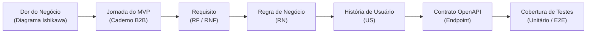

# Matriz de Rastreabilidade Bidirecional

A rastreabilidade bidirecional (*Forward & Backward Traceability*) garante que toda funcionalidade do sistema **Alçadas** decorre diretamente de uma dor comprovada da cliente (**Startop LTDA**) e que cada linha de código/endpoint possui requisitos, regras de negócio e testes associados.

---

## 1. Visão Geral da Rastreabilidade de Ponta a Ponta

---

## 2. Matriz Integrada de Rastreabilidade

| Dor Original (Ishikawa) | Jornada MVP | Requisito Funcional | Regra de Negócio | História de Usuário (US) | Endpoint OpenAPI v0.1 | Casos de Teste Associados |
| :--- | :--- | :--- | :--- | :--- | :--- | :--- |
| Ausência de limites claros de aprovação por cargo | Jornada 1: Configuração | **RF01** | **RN01** (Tetos por nível) | **US-01** (Configurar Alçadas) | `POST /tenants/{tId}/cost-centers` `PUT /tenants/{tId}/tiers` | `test_cost_center_limits_creation` `test_tier_validation` |
| Pedidos soltos em mensagens de WhatsApp | Jornada 2: Submissão | **RF02** | **RN02** (Justificativa obrigatória) | **US-02** (Submeter Pedido) | `POST /api/v1/requests` | `test_request_creation_valid` `test_missing_justification_rejection` |
| Autoaprovação indevida de despesas pessoais | Jornada 3: Decisão & SoD | **RF03** | **RN03** (Bloqueio SoD) | **US-03**, **US-04** (Painel & SoD) | `POST /api/v1/requests/{id}/approve` | `test_sod_self_approval_blocked_403` `test_decision_state_transition` |
| Gargalo por ausência/férias de diretores | Jornada 3: Delegação | **RF04** | **RN04** (Vigência com timer) | **US-10** (Delegação Temporária) | `POST /api/v1/delegations` `GET /api/v1/delegations/active` | `test_delegation_timer_expiration` `test_delegated_approval_within_dates` |
| Compras fracionadas para burlar alçadas superiores | Jornada 4: Riscos | **RF05** | **RN05** (Janela móvel 30 dias) | **US-06** (Detecção de Fracionamento) | `POST /api/v1/requests` (Risk Check) | `test_split_request_escalation_to_director` `test_sliding_window_30d_calculation` |
| Pagamentos em duplicidade para mesmo fornecedor | Jornada 4: Riscos | **RF06** | **RN06** (Janela móvel 7 dias) | **US-12** (Alerta de Duplicidade) | `POST /api/v1/requests` (Risk Check) | `test_duplicate_request_warning_flag` `test_exact_match_vendor_and_amount` |
| Planilhas adulteradas e falta de trilha contábil | Jornada 5: Auditoria | **RF07** | **RN07** (Cadeia de Hashes SHA-256) | **US-07** (Registro de Selos) | `GET /api/v1/requests/{id}/audit-blocks` | `test_sha256_genesis_and_chain_linking` `test_immutable_payload_storage` |
| Incerteza sobre violação direta de dados no banco | Jornada 5: Auditoria | **RF08** | **RN08** (Recálculo da Cadeia) | **US-08** (Verificação de Integridade) | `GET /api/v1/requests/{id}/audit-trail/verify` | `test_tampered_database_detection_under_1s` `test_valid_chain_recalculation` |
| Dificuldade de prestar contas ao Fisco/Auditoria | Jornada 5: Auditoria | **RF09** | **RN09** (Exportação com carimbo) | **US-13** (Exportação Auditável) | `GET /api/v1/requests/{id}/export` | `test_csv_json_export_structure` `test_export_includes_all_hashes` |
| Rejeição de pedidos sem canal de retificação | Jornada 3: Ciclo de Vida | **RF10** | **RN10** (Status EM_AJUSTE) | **US-11** (Reenvio após Ajuste) | `PUT /api/v1/requests/{id}` | `test_resubmit_em_ajuste_success` `test_edit_blocked_when_pending` |
| Decisões concorrentes gerando duplicidade | Desafio de Engenharia | **RF11** | **RN11** (Transação Atômica) | **US-05** (Concorrência Otimista) | `POST /api/v1/requests/{id}/approve` | `test_concurrent_decisions_second_fails_409` `test_firestore_transaction_isolation` |
| Delegação burlada para autoaprovação indireta | Jornada 4: SoD Avançado | **RF12** | **RN12** (Bloqueio SoD em Delegação) | **US-14** (SoD em Substitutos) | `POST /api/v1/requests/{id}/approve` | `test_delegate_cannot_approve_own_expense_403` |

---

## 3. Rastreabilidade dos Requisitos Não Funcionais (RNFs)

| Cód | Requisito Não Funcional | Meta Mensurável | Componente Responsável | Estratégia de Validação / Teste |
| :--- | :--- | :--- | :--- | :--- |
| **RNF01** | Sincronização em Tempo Real | $< 1,5$ s entre backend e interfaces abertas | Firestore Real-time Streams + Angular | Teste E2E de latência de propagação de eventos. |
| **RNF02** | Imutabilidade e Integridade | Validação de cadeia SHA-256 em $< 1$ s | `CryptoAuditService` (Node.js crypto) | Benchmark automatizado com cadeia de 1.000 elos. |
| **RNF03** | Segregação de Funções e RBAC | 100% de rejeição (`HTTP 403`) fora de papel | `FirebaseAuthGuard`, `RBACGuard`, `SoDGuard` | Testes de matriz de permissões cobrindo todos os endpoints. |
| **RNF04** | Retenção Legal e LGPD | 5 anos de retenção e posterior anonimização | Rotina de Expurgos / Cloud Scheduler | Teste unitário da função de higienização de autor. |
| **RNF05** | Padronização em Contêineres | 100% reprodutível via imagem Docker | `Dockerfile`, `docker-compose.yml` | Pipeline de CI executando build e smoke tests nos contêineres. |
| **RNF06** | Controle Orçamentário Nuvem | Gastos GCP $< \text{US\$} 5,00$ até Sem. 4 / Teto US$ 50 | GCP Budget Alerts (50%, 80%, 100%) | Relatório de custos gerado semanalmente pelo Cloud Billing. |
| **RNF07** | Isolamento Multi-tenant | 100% de bloqueio (`HTTP 403/404`) de cross-tenant | `TenantContextService` + Firestore Rules | Teste automatizado tentando ler doc do Tenant B com JWT do Tenant A. |
| **RNF08** | Estados Visuais de Interface | 100% das telas com Loading, Empty e Error | Componentes de UI Angular | Testes de snapshot e validação visual de QA do *DoD*. |
| **RNF09** | Omissão de PII em Logs | 0 ocorrências de PII, senhas ou tokens em logs | Interceptor NestJS `SanitizeLogsInterceptor` | Auditoria estática de logs de saída durante suíte de testes. |
| **RNF10** | Emuladores Locais 100% Offline | `docker compose up` sem dependência de nuvem | Firebase Auth & Firestore Emulators | Teste em máquina isolada sem conexão externa à internet. |
