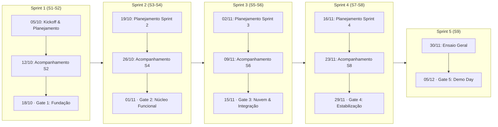
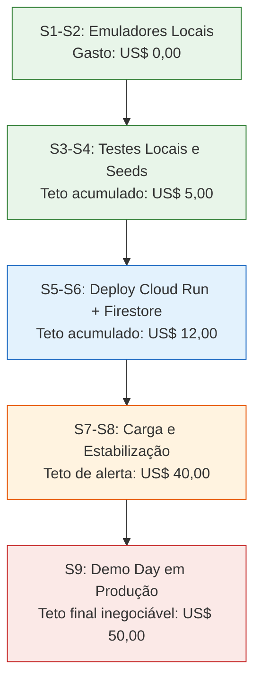

# Cronograma do Projeto e Plano de Execução

Este documento estabelece o **planejamento temporal, a cadência ágil e o cronograma de marcos (gates)** do projeto **Alçadas**, estruturado estritamente em conformidade com o **Caderno de Projetos B2B v2 (AI LAB / MAKERS)** e o documento oficial de [Checkpoints e Pontos de Controle B2B](../assets/Checkpoints_e_Pontos_de_Controle_B2B.pdf).

O ciclo total compreende **9 semanas de execução (04/10/2026 a 05/12/2026)**, organizado em **Sprints de 2 (duas) semanas**, com **reuniões semanais de alinhamento e controle sempre às segundas-feiras**.

---

## 1. Estrutura do Ciclo e Modelo de Governança

### 1.1. Regras Operacionais da Equipe
- **Duração das Sprints:** 2 semanas para desenvolvimento incremental (Sprints 1 a 4) + 1 semana dedicada para homologação final e ensaios (Sprint 5);
- **Reuniões de Sincronização:** Todas as **segundas-feiras (20 a 30 minutos)**, estruturadas sob o roteiro padrão de 7 perguntas do Guia B2B;
- **Critério de Passagem (Regra de Gate):** O avanço para a sprint subsequente exige que as evidências estejam registradas no repositório, com testes passando, CI verde e validação reproduzível por outro membro da equipe (*Definition of Done*). Não basta "funcionar na máquina do desenvolvedor".

---

## 2. Visão Geral das Sprints e Checkpoints Oficiais

| Sprint / Período | Semanas | Gate Oficial B2B | Data Limite | Objetivo Principal | Meta FinOps (GCP) | Entregáveis Críticos |
| :--- | :--- | :--- | :--- | :--- | :--- | :--- |
| **Sprint 1** 05/10 a 18/10/2026 | S1 e S2 | **Checkpoint 1 — Fundação** | **18/10/2026** | Validar problema, escopo, arquitetura e ambiente local. | US$ 0,00 acumulado *(100% emuladores)* | Visão do Produto, Ishikawa, Backlog MoSCoW, 7 ADRs, OpenAPI v0.1, DoD, Estratégia de Testes, Monorepo Nx, Docker Compose com emuladores. |
| **Sprint 2** 19/10 a 01/11/2026 | S3 e S4 | **Checkpoint 2 — Núcleo Funcional** | **01/11/2026** | Validar o fluxo ponta a ponta das jornadas do MVP rodando localmente. | Gasto acumulado **≤ US$ 5,00** | 3 a 5 jornadas funcionais locais, formulários reativos, máquina de estados atômica, anti-fracionamento, Security Rules *deny-all*, testes EP/BVA v1. |
| **Sprint 3** 02/11 a 15/11/2026 | S5 e S6 | **Checkpoint 3 — Nuvem e Integração** | **15/11/2026** | Validar publicação em nuvem, observabilidade e infraestrutura segura. | Gasto acumulado **≤ US$ 12,00** | Deploy no Firebase Hosting + Cloud Run, rewrite `/api`, `/healthz`, `/readyz`, logs JSON estruturados, Workload Identity Federation (sem chaves JSON). |
| **Sprint 4** 16/11 a 29/11/2026 | S7 e S8 | **Checkpoint 4 — Qualidade e Estabilização** | **29/11/2026** | Congelamento de escopo (*feature freeze*), confiabilidade e ensaio de contingência. | Teto preventivo em **US$ 40,00** *(Trigger de corte)* | Cobertura ≥80% domínio / ≥60% global, zero bugs críticos, zero vulnerabilidade alta/crítica, Lighthouse ≥90, rollback ensaiado, exportação Firestore. |
| **Sprint 5** 30/11 a 05/12/2026 | S9 | **Checkpoint Final — Demo Day** | **05/12/2026** | Homologação final, validação da defensibilidade e apresentação do produto. | Teto orçamentário **≤ US$ 50,00** | Produção estável, smoke test pós-deploy verde, demonstração ao vivo da defensibilidade (< 1 s em anti-fracionamento e quebra de hash SHA-256). |

---

## 3. Detalhamento das Sprints e Agenda de Reuniões de Segunda-Feira

### Sprint 1: Fundação e Arquitetura Base (05/10 a 18/10/2026)
*Foco: Problema, escopo, arquitetura, ambiente emulado e governança.*

- **Reunião 1 (Segunda-feira, 05/10/2026) — Kickoff & Planejamento Inicial:**
  - Alinhamento da parceria com **Julia Campos Santana** ([Startop LTDA](visao-produto.md#11-identificacao-do-clienteparceiro));
  - Elaboração da [Visão de Produto](visao-produto.md) e do Diagrama de Ishikawa (6M's);
  - Definição da stack tecnológica (Angular, NestJS, Firestore, Firebase Auth, Docker);
  - Distribuição dos papéis da equipe (PO, Tech Lead, DevOps, Backend, Frontend, QA).
- **Reunião 2 (Segunda-feira, 12/10/2026) — Sincronização S2 & Preparação do Gate 1:**
  - Avaliação do monorepo Nx e orquestração do `docker compose up` com emuladores;
  - Revisão da [Estratégia de Testes](../testes/estrategia_de_testes.md) e do [Definition of Done](../governanca/dod.md);
  - Redação das ADRs fundamentais ([ADR-001](../arquitetura/adrs/ADR-001-monorepo-nx.md) a [ADR-007](../arquitetura/adrs/ADR-007-rbac-e-sod.md)) e especificação [OpenAPI v0.1](../api/index.md).
- **Entrega Oficial — Checkpoint 1 (Domingo, 18/10/2026):**
  - **Evidências auditadas:** Repositório configurado; CI com lint e build verdes; seed de dados reproduzível; 0 segredos expostos (`.env.example` sanitizado); alertas de billing na GCP em 50%, 80% e 100%.

---

### Sprint 2: Núcleo Funcional e Regras de Segurança (19/10 a 01/11/2026)
*Foco: Jornadas principais do MVP rodando localmente, máquina de estados e validações de risco.*

- **Reunião 3 (Segunda-feira, 19/10/2026) — Planejamento da Sprint 2 & Review do Gate 1:**
  - Apresentação e homologação das [Personas do Usuário](personas.md) (Carlos, Mariana e Patrícia);
  - Decomposição das histórias do grupo **Must** do MoSCoW:
    - [`US-01`](../historias-usuario.md#41-must-essencial-para-o-mvp-e-o-demo-day): Parametrização de centros de custo e faixas de alçada (`RF01`);
    - [`US-02`](../historias-usuario.md#41-must-essencial-para-o-mvp-e-o-demo-day): Submissão de compras com formulários reativos e justificativa (`RF02`);
    - [`US-03`](../historias-usuario.md#41-must-essencial-para-o-mvp-e-o-demo-day): Painel de decisão do aprovador (`RF03`);
    - [`US-05`](../historias-usuario.md#41-must-essencial-para-o-mvp-e-o-demo-day): Tratamento de concorrência com transações atômicas (`RF11`);
    - [`US-06`](../historias-usuario.md#41-must-essencial-para-o-mvp-e-o-demo-day): Motor anti-fracionamento em janela de 30 dias (`RF05`);
    - [`US-07`](../historias-usuario.md#41-must-essencial-para-o-mvp-e-o-demo-day): Cadeia de hashes SHA-256 encadeada (`RF07`).
- **Reunião 4 (Segunda-feira, 26/10/2026) — Acompanhamento S4 & Preparação do Gate 2:**
  - Checagem dos testes de autorização e Security Rules *deny-all* no Firestore;
  - Validação dos estados visuais de tela (*loading*, *empty*, *error* conforme `RNF08`);
  - Verificação de consumo FinOps local (custo GCP acumulado < US$ 5,00).
- **Entrega Oficial — Checkpoint 2 (Domingo, 01/11/2026):**
  - **Evidências auditadas:** Demonstração da jornada completa localmente sem intervenção manual; suíte EP/BVA v1 executando; matriz de rastreabilidade Requisito $\to$ Aceite $\to$ Teste atualizada; bloqueio efetivo de tentativas de autoaprovação (*SoD* - `RF12`).

---

### Sprint 3: Nuvem, Integração Contínua e Observabilidade (02/11 a 15/11/2026)
*Foco: Deploy contínuo em ambiente de homologação/produção, métricas operacionais e segurança de infraestrutura.*

- **Reunião 5 (Segunda-feira, 02/11/2026) — Planejamento da Sprint 3 & Review do Gate 2:**
  - Planejamento do pipeline de entrega contínua para **Firebase Hosting** (Frontend Angular) e **Google Cloud Run** (Backend NestJS);
  - Implementação de autenticação via **Workload Identity Federation (WIF)** no GitHub Actions, eliminando credenciais de serviço permanentes;
  - Configuração do rewrite `/api` para roteamento unificado sob o mesmo domínio.
- **Reunião 6 (Segunda-feira, 09/11/2026) — Acompanhamento S6 & Preparação do Gate 3:**
  - Implementação dos endpoints de sondagem operacional `/healthz` e `/readyz`;
  - Padronização de logs estruturados em formato JSON com `requestId`, `rota`, `status`, `latência` e ausência de dados PII (`RNF09`);
  - Configuração de alertas para erros `5xx` e degradação de latência ($p95 > 1{,}5\text{ s}$);
  - Auditoria de FinOps: checagem de leitura/escrita no Firestore e conferência do gasto acumulado ($\le \text{US\$} 12{,}00$).
- **Entrega Oficial — Checkpoint 3 (Domingo, 15/11/2026):**
  - **Evidências auditadas:** Usuário externo acessa a URL de homologação, efetua login via Firebase Auth, cria uma solicitação e a decisão é refletida em tempo real sem erros de CORS ou dependência de ambiente local.

---

### Sprint 4: Qualidade, Estabilização e Auditoria (16/11 a 29/11/2026)
*Foco: Congelamento de escopo (Feature Freeze), cobertura rigorosa, testes de carga, ensaio de rollback e blindagem de segurança.*

- **Reunião 7 (Segunda-feira, 16/11/2026) — Planejamento da Sprint 4 & Feature Freeze:**
  - Decretado o **Congelamento de Escopo (*Feature Freeze*)** — proibida a inclusão de novas features; foco total em confiabilidade;
  - Reforço da suíte de testes de integração e ponta a ponta (`US-08` — detecção de registros adulterados em menos de 1 s);
  - Testes das histórias do grupo **Should**: delegação temporária (`US-10`), resolução de ajustes (`US-11`), duplicidade (`US-12`) e exportação CSV/JSON (`US-13`).
- **Reunião 8 (Segunda-feira, 23/11/2026) — Acompanhamento S8 & Ensaio de Contingência:**
  - Execução e registro do **ensaio de rollback** em produção/staging;
  - Teste de exportação manual e restauração da base Firestore;
  - Varredura de segurança contra vulnerabilidades (Dependabot, SAST, auditoria de imagens Docker com digest SHA);
  - Auditoria de performance Lighthouse ($> 90$ em Desktop/Mobile) e conferência do gatilho de segurança orçamentária (limite preventivo de US$ 40,00).
- **Entrega Oficial — Checkpoint 4 (Domingo, 29/11/2026):**
  - **Evidências auditadas:** Cobertura de testes $\ge 80\%$ no domínio e $\ge 60\%$ global; zero vulnerabilidades críticas/altas; pipeline bloqueante em caso de falha; relatório de qualidade publicado em `/docs/testes`.

---

### Sprint 5: Reta Final, Homologação e Demo Day (30/11 a 05/12/2026)
*Foco: Homologação em ambiente de produção, ensaios da apresentação e defesa técnica perante a banca.*

- **Reunião 9 (Segunda-feira, 30/11/2026) — Ensaio Geral & Roteiro da Demonstração:**
  - Alinhamento do roteiro da apresentação executiva com foco em:
    1. **Problema e Contexto:** A dor da Startop LTDA (Ishikawa e perdas financeiras por aprovações informais);
    2. **Solução e Arquitetura:** Máquina de estados atômica e segregação estrita de funções (*SoD*);
    3. **Apresentação da Jornada Principal:** Carlos solicitando, Mariana aprovando e Patrícia auditando;
    4. **Comprovação da Defensibilidade:** Demonstração ao vivo do bloqueio de compras fracionadas em < 1 s e quebra detectada na cadeia SHA-256 após edição direta no banco de dados;
    5. **Evidências de Engenharia:** Métricas de cobertura, observabilidade, conformidade com a LGPD e relatório final de custos FinOps.
- **Quarta a Sexta-feira (02 a 04/12/2026):**
  - Rodadas de *dry run* (testes cegos de apresentação) com tempo cronometrado;
  - Verificação de estabilidade dos endpoints `/healthz` e `/readyz` em produção;
  - Preparação da massa de dados limpa e controlada (*seed* oficial da demo).
- **Checkpoint Final — Demo Day (Sábado, 05/12/2026):**
  - **Apresentação oficial e homologação do MVP Alçadas perante a banca examinadora e stakeholders.**

---

## 4. Rito da Reunião Semanal de Segunda-feira (As 7 Perguntas)

Todas as reuniões de segunda-feira seguem estritamente a pauta de 20 a 30 minutos estabelecida no Caderno B2B:

| # | Pergunta Guia | Evidência Exigida | Responsável Primário |
| :-: | :--- | :--- | :--- |
| **1** | **O que foi concluído?** | *Pull Request* aprovado, *issue* fechada no GitHub Projects ou feature demonstrada funcionando. | Tech Lead / Desenvolvedores |
| **2** | **O que está bloqueado?** | Impedimento registrado formalmente, com impacto nas histórias e indicação de responsável pela tratativa. | Toda a equipe / PO |
| **3** | **Qual critério foi coberto?** | Caso de teste automatizado implementado vinculado aos critérios de aceite da User Story. | QA Lead (Leticia) |
| **4** | **Qual risco aumentou?** | Registro atualizado na matriz de riscos, novo ADR elaborado ou plano de contingência acionado. | Tech Lead (Henrique) / PO (Matheus) |
| **5** | **Quanto já gastamos?** | Consulta ao painel do GCP Billing, comparativo com a curva esperada da sprint e saldo restante dos US$ 50,00. | DevOps (Pedro Henrique) |
| **6** | **O que será feito na próxima semana?** | Histórias priorizadas da sprint com responsáveis explícitos e critérios de pronto (*DoD*) revisados. | PO (Matheus) / Time de Desenvolvimento |
| **7** | **O que precisa de tutor/cliente?** | Dúvida técnica ou de negócio sintetizada de forma objetiva, com contexto e prazo limite para decisão. | PO em alinhamento com Julia Campos Santana |

---

## 5. Curva de Gastos FinOps (Teto Orçamentário GCP: US$ 50,00)

O controle orçamentário é parte integrante dos critérios de avaliação do projeto, operando com alertas e gatilhos de corte:

- **Alerta 1 (50% do orçamento — US$ 25,00):** Notificação automática via Cloud Monitoring para o Tech Lead e DevOps;
- **Alerta 2 (80% do orçamento — US$ 40,00):** Acionamento do protocolo de contingência: redução imediata de instâncias no Cloud Run (`min-instances=0`, `max-instances=2`), desligamento de jobs do Cloud Scheduler não essenciais e suspensão de testes de carga pesados na nuvem;
- **Alerta 3 (100% do orçamento — US$ 50,00):** Travamento total de escalabilidade e contenção de custos para evitar gastos excedentes.

---

> [!IMPORTANT] Rastreabilidade com a Definition of Done
> Cada marco estabelecido neste cronograma só é considerado cumprido quando os artefatos de código, testes, infraestrutura e documentação satisfizerem integralmente as regras da [Definition of Done (DoD)](../governanca/dod.md) do projeto.
