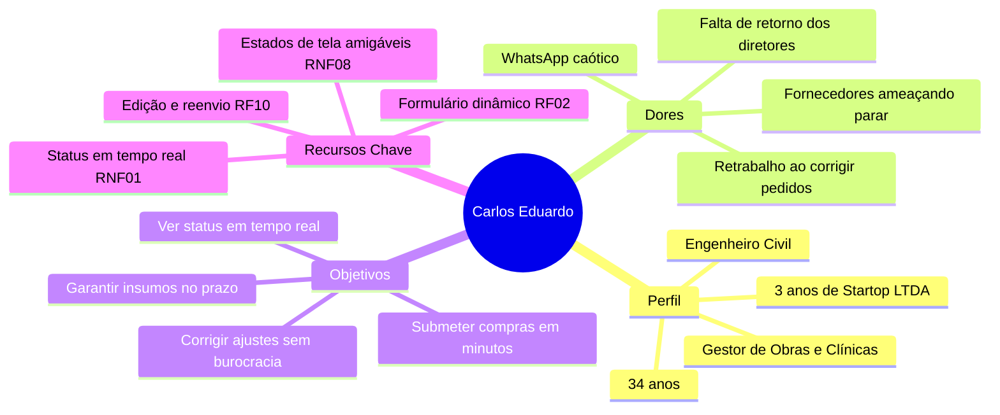
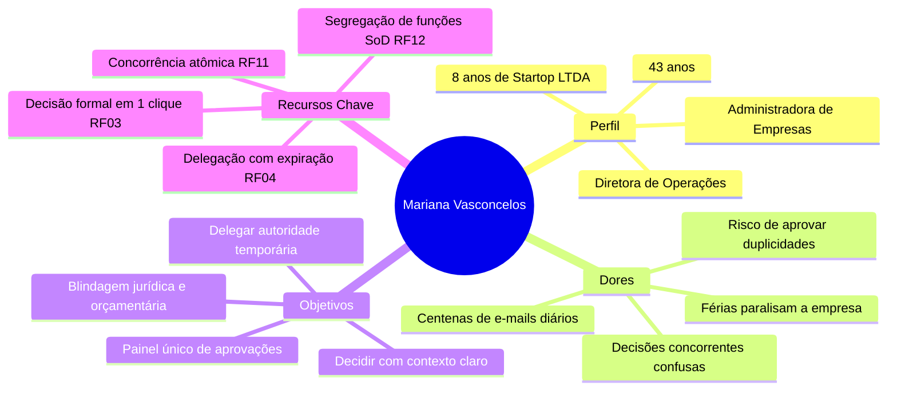
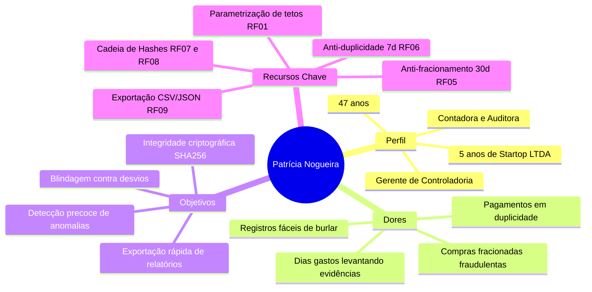
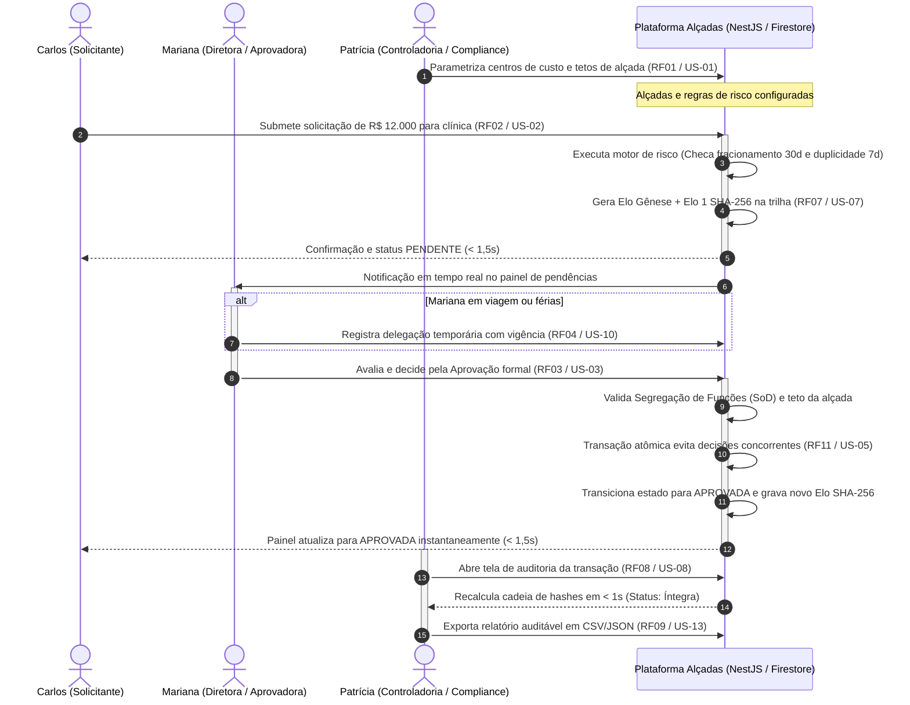

# Personas do Usuário

Este documento apresenta as **personas do usuário** desenvolvidas para o projeto **Alçadas**, concebidas a partir do contexto real de negócios da **Startop LTDA** (prestadora de serviços para clínicas, franquias e construtoras médias) e de sua representante e parte interessada, **Julia Campos Santana**.

As personas sintetizam os comportamentos, necessidades, frustrações e motivações dos perfis identificados na [Segmentação de Clientes da Visão do Produto](visao-produto.md#15-segmentacao-de-clientes), servindo como bússola para o design de interação, priorização de funcionalidades e validação dos critérios de aceitação do sistema.

---

## 1. Visão Geral e Quadro Comparativo

Estabelecemos **3 personas principais** que cobrem as extremidades operacionais, executivas e fiscalizatórias do fluxo de alçadas de aprovação, complementadas pela atuação do papel administrativo do sistema:

| Persona | Papel Organizacional | Papel no Sistema (RBAC) | Foco Principal de Atuação | Principal Dor no Cenário Informal | Valor Entregue pelo Alçadas | Jornadas do MVP |
| :--- | :--- | :--- | :--- | :--- | :--- | :--- |
| **Carlos Eduardo "Cadu"** | Gestor de Operações & Obras | `SOLICITANTE` | Administração de contratos em campo (obras e clínicas parceiras). | Pedidos perdidos no WhatsApp/e-mail e falta de visibilidade do status. | Submissão padronizada, histórico transparente e reenvio ágil de ajustes. | **J2** (Submissão) e **J3** (Resolução de Ajustes) |
| **Mariana Vasconcelos** | Diretora Executiva de Operações | `SUPER_USER` / `USER_NORMAL` | Liderança tática, gestão orçamentária e tomada de decisão. | Sobrecarga de mensagens, gargalo na esteira durante viagens e concorrência em planilhas. | Painel ágil em tempo real, decisões seguras e delegação temporária programável. | **J3** (Decisão e Delegação) |
| **Patrícia Nogueira** | Gerente de Controladoria & Compliance | `ADMIN` / Auditoria | Governança corporativa, conformidade fiscal e prestação de contas. | Planilhas adulteráveis, compras fracionadas indetectadas e auditorias morosas. | Trilha imutável em SHA-256, travas anti-fracionamento e verificação em < 1 s. | **J1** (Parametrização), **J4** (Riscos) e **J5** (Auditoria) |

---

## 2. Persona 1: Carlos Eduardo "Cadu" Mendes — O Solicitante na Ponta

> *"O caminhão de insumos ou a manutenção urgente da clínica não podem esperar três dias para o diretor ver uma mensagem no WhatsApp. Preciso lançar o pedido em dois minutos e acompanhar exatamente quem está avaliando."*

### 2.1. Perfil Demográfico e Profissional
- **Idade:** 34 anos
- **Formação:** Graduação em Engenharia Civil com especialização em Gestão de Obras e Serviços.
- **Cargo:** Gestor de Operações e Obras na Startop LTDA (atua há 3 anos na empresa).
- **Local de Atuação:** Focado em campo, administrando reformas e equipes técnicas em duas clínicas médicas parceiras e uma construtora média contratante da Startop.
- **Dispositivos Usuais:** Smartphone Android durante vistorias e notebook corporativo nos escritórios das filiais.

### 2.2. Contexto e Rotina
Carlos é responsável por assegurar que os serviços prestados pela Startop LTDA ocorram sem interrupções. Ele lida com pedidos urgentes de materiais de construção, peças de reposição para consultórios, contratação de pequenos serviços técnicos e reembolsos de alimentação e combustível para seus times. Seu dia a dia é dinâmico, dividido entre canteiros de obra, clínicas em funcionamento e reuniões com mestres de obras e gerentes de filial.

### 2.3. Dores e Frustrações no Cenário Atual
- **Processos Informais e Perdidos:** Envios de notas fiscais, fotos de recibos e cotações por e-mail ou WhatsApp que se perdem nas conversas diárias dos diretores.
- **Opacidade no Andamento:** Ausência total de visibilidade sobre em qual etapa da aprovação seu pedido está, forçando-o a cobrar os gestores insistentemente.
- **Atrasos e Cobranças de Fornecedores:** Fornecedores de insumos ameaçam paralisar o trabalho porque as ordens de compra demoram dias para serem formalizadas.
- **Retrabalho Excessivo:** Quando um diretor rejeitava uma compra por ausência de cotação ou erro formal em uma planilha, Carlos precisava recriar toda a requisição manualmente.

### 2.4. Objetivos e Motivações
- Registrar solicitações de compra, pagamento ou reembolso de forma rápida e sem atritos burocráticos.
- Acompanhar de forma instantânea se o pedido foi recebido, se está sob análise ou se necessita de complementação.
- Poder corrigir apenas os pontos solicitados (ajustes de anexo ou texto) sem precisar cancelar e refazer todo o fluxo.

### 2.5. Mapa de Empatia

| Dimensão | O que o Carlos vivencia na Startop LTDA |
| :--- | :--- |
| **O que pensa e sente?** | *"Se o insumo não chegar na clínica amanhã, o cliente culpa a minha equipe"*; Sente ansiedade pela falta de resposta dos gestores e frustração com a burocracia desordenada. |
| **O que ouve?** | Fornecedores cobrando: *"Preciso do pedido aprovado para liberar o material"*; Mestres de obra reclamando de ferramentas paradas; Diretores pedindo *"Manda no meu e-mail que depois vejo"*. |
| **O que vê?** | Planilhas com versões conflitantes circulando por e-mail; mensagens no WhatsApp marcadas como lidas sem resposta de aprovação. |
| **O que fala e faz?** | Tenta manter um controle pessoal paralelo em caderno ou notas no celular; liga insistentemente para a diretoria cobrando agilidade nas compras críticas. |

### 2.6. Relação Direta com o Sistema Alçadas
- **Submissão Guiada de Pedidos ([`RF02`](../requisitos.md#31-requisitos-funcionais-rfs), [`US-02`](../historias-usuario.md#41-must-essencial-para-o-mvp-e-o-demo-day)):** Utiliza o formulário inteligente com validação dinâmica de campos obrigatórios (centro de custo, valor, categoria e justificativa com mais de 30 caracteres para valores elevados).
- **Atualização Instantânea ([`RNF01`](../requisitos.md#32-requisitos-nao-funcionais-rnfs), [`US-14`](../historias-usuario.md#42-should-importante-entra-se-o-prazo-permitir)):** Vê seu painel atualizar automaticamente em menos de 1,5 s sem recarregar a tela quando o status muda para `APROVADA`, `REJEITADA` ou `EM_AJUSTE`.
- **Tratamento de Ajustes e Reenvio ([`RF10`](../requisitos.md#31-requisitos-funcionais-rfs), [`US-11`](../historias-usuario.md#42-should-importante-entra-se-o-prazo-permitir)):** Edita dados e adiciona novos comprovantes diretamente na solicitação com status `EM_AJUSTE`, reenviando-a para a fila sem retrabalho.

---

## 3. Persona 2: Mariana Vasconcelos — A Aprovadora Tática e Executiva

> *"Minha equipe precisa de velocidade para cumprir os cronogramas das clínicas e obras, mas a empresa não pode operar no escuro. Preciso de um painel confiável onde eu aprove em segundos e consiga delegar minha alçada com segurança durante minhas viagens."*

### 3.1. Perfil Demográfico e Profissional
- **Idade:** 43 anos
- **Formação:** Administração de Empresas com MBA em Gestão Financeira Corporativa.
- **Cargo:** Diretora Executiva de Operações e Serviços na Startop LTDA (8 anos de empresa).
- **Local de Atuação:** Matriz corporativa, mas viaja quinzenalmente para visitar clientes e fiscalizar contratos em outras localidades.
- **Dispositivos Usuais:** Ultrabook corporativo e tablet para consultas e aprovações rápidas em trânsito.

### 3.2. Contexto e Rotina
Mariana gerencia os gestores de operações (como Carlos) e supervisiona mais de 15 centros de custo distintos. Possui teto de aprovação executivo elevado (alçada de até R$ 50.000,00). Sua rotina é repleta de reuniões estratégicas com diretores de clínicas e empreiteiras. Recebe um grande volume de pedidos para avaliar todos os dias e responde diretamente pelos gastos e pela rentabilidade das contas que lidera.

### 3.3. Dores e Frustrações no Cenário Atual
- **Caixa de Entrada Inundada:** Dezenas de mensagens desordenadas por dia pedindo aprovação de compras de valores que variam de R$ 100,00 a R$ 45.000,00, sem triagem ou contexto adequado.
- **Gargalo nas Ausências:** Quando entra em reuniões prolongadas, viagens de campo ou férias, as compras da empresa ficavam paradas, ou ela se via forçada a repassar suas credenciais informalmente a terceiros.
- **Inconsistências em Decisões Concorrentes:** Na rotina informal em planilhas compartilhadas, ocorriam situações em que ela e outro gestor alteravam a mesma linha simultaneamente, gerando duplicidade ou perda de dados.
- **Risco de Assinar no Escuro:** Dificuldade em averiguar rapidamente se um pedido já havia sido pago ou se continha cotações válidas anexadas.

### 3.4. Objetivos e Motivações
- Ter uma visão consolidada e limpa de todas as solicitações pendentes que aguardam especificamente sua alçada.
- Tomar decisões formais em poucos cliques (Aprovar, Rejeitar ou Pedir Ajuste) com justificativas registradas para resguardar sua responsabilidade civil e profissional.
- Poder programar transferências temporárias de competência para substitutos qualificados com vigência pré-estabelecida, garantindo a continuidade do negócio.

### 3.5. Mapa de Empatia

| Dimensão | O que a Mariana vivencia na Startop LTDA |
| :--- | :--- |
| **O que pensa e sente?** | *"Preciso garantir agilidade para as obras sem estourar o orçamento dos centros de custo"*; Preocupa-se em não se tornar o gargalo da operação e em resguardar sua governança. |
| **O que ouve?** | Solicitantes cobrando: *"Mariana, olha meu pedido de ontem no WhatsApp?"*; Controladoria alertando sobre gastos fora da curva; Clientes exigindo cumprimento rigoroso de prazos. |
| **O que vê?** | Filas de e-mails não lidos marcados como urgentes; planilhas sem assinatura formal; colaboradores tentando resolver pagamentos no improviso. |
| **O que fala e faz?** | Reclama da falta de filtros nos pedidos; cobra justificativas detalhadas para valores atípicos; exige respeito aos tetos orçamentários acordados. |

### 3.6. Relação Direta com o Sistema Alçadas
- **Painel de Decisão em Tempo Real ([`RF03`](../requisitos.md#31-requisitos-funcionais-rfs), [`US-03`](../historias-usuario.md#41-must-essencial-para-o-mvp-e-o-demo-day)):** Aprova, rejeita ou solicita ajustes de forma fundamentada diretamente na interface web, exigindo motivo mínimo de 10 caracteres para recusas ou devoluções.
- **Delegação Temporária de Competência ([`RF04`](../requisitos.md#31-requisitos-funcionais-rfs), [`US-10`](../historias-usuario.md#42-should-importante-entra-se-o-prazo-permitir)):** Transfere seu poder decisório para um substituto habilitado indicando data/hora de início e término, com revogação e expiração automáticas.
- **Controle de Decisões Concorrentes ([`RF11`](../requisitos.md#31-requisitos-funcionais-rfs), [`US-05`](../historias-usuario.md#41-must-essencial-para-o-mvp-e-o-demo-day)):** Suas decisões utilizam transações atômicas no backend NestJS/Firestore, prevenindo conflitos concorrentes (`HTTP 409 Conflict`) caso um substituto tente decidir ao mesmo tempo.
- **Segregação Estrita de Funções ([`RF12`](../requisitos.md#31-requisitos-funcionais-rfs), [`US-04`](../historias-usuario.md#41-must-essencial-para-o-mvp-e-o-demo-day)):** Fica protegida pelas regras do sistema que barram tentativas de autoaprovação, assegurando conformidade inquestionável com auditorias.

---

## 4. Persona 3: Patrícia Nogueira — A Guardiã da Governança e Auditoria

> *"Para a auditoria externa e para a prestação de contas aos nossos clientes, um 'ok' no WhatsApp ou uma planilha editável têm valor probatório nulo. Precisamos de garantias matemáticas imutáveis de que cada aprovação respeitou os limites legais e de que o histórico nunca foi adulterado."*

### 4.1. Perfil Demográfico e Profissional
- **Idade:** 47 anos
- **Formação:** Ciências Contábeis com MBA em Controladoria, Auditoria e Perícia Contábil; Certificação em Compliance Corporativo.
- **Cargo:** Gerente de Controladoria, Riscos e Auditoria Interna na Startop LTDA (5 anos na empresa).
- **Local de Atuação:** Matriz da Startop LTDA, reportando diretamente à liderança executiva e a **Julia Campos Santana**.
- **Dispositivos Usuais:** Estação de trabalho corporativa com monitor duplo para análise densa de dados financeiros e relatórios de auditoria.

### 4.2. Contexto e Rotina
Patrícia é responsável por blindar a Startop LTDA contra riscos financeiros, fraudes, inconformidades fiscais e passivos legais. Ela fiscaliza as contas dos centros de custo, coordena auditorias internas e atende às auditorias externas exigidas pelas redes de clínicas e construtoras contratantes. Dedica seu tempo ao cruzamento de notas fiscais, verificação de conciliações e validação de conformidade com a LGPD e governança corporativa.

### 4.3. Dores e Frustrações no Cenário Atual
- **Registros Vulneráveis a Adulteração:** No modelo baseado em planilhas compartilhadas e bancos convencionais sem assinatura digital, qualquer usuário com privilégios podia alterar datas, valores e aprovadores sem deixar registro legível.
- **Fracionamento Intencional de Despesas:** Gestores operacionais dividiam compras propositalmente (por exemplo, emitindo três pedidos de R$ 4.800,00) para manter o valor abaixo do teto de alçada inferior (R$ 5.000,00) e fugir da avaliação da diretoria.
- **Pagamentos em Duplicidade:** Falta de inteligência de cruzamento de dados que permitia que a mesma despesa fosse submetida e paga em semanas consecutivas com notas fiscais similares.
- **Consumo Exaustivo de Tempo em Auditorias:** Semanas inteiras gastas reunindo e-mails antigos, capturas de tela e comprovantes dispersos para comprovar quem aprovou determinado gasto a auditores independentes.
- **Preocupação com a LGPD e Retenção:** Ausência de controle automatizado sobre o tempo de armazenamento e descarte de dados pessoais corporativos.

### 4.4. Objetivos e Motivações
- Eliminar o risco de fraudes e compras fracionadas por meio de bloqueios preventivos automatizados no sistema.
- Dispor de uma trilha de auditoria à prova de adulterações (*tamper-proof*), respaldada por criptografia.
- Conseguir verificar a integridade da base e exportar relatórios completos de conformidade em poucos segundos durante fiscalizações.
- Assegurar conformidade absoluta com a Lei Geral de Proteção de Dados (LGPD) e segregação de funções (*Separation of Duties - SoD*).

### 4.5. Mapa de Empatia

| Dimensão | O que a Patrícia vivencia na Startop LTDA |
| :--- | :--- |
| **O que pensa e sente?** | *"Se houver uma fraude orçamentária ou se formos reprovados na auditoria do cliente, a credibilidade da Startop LTDA desaba"*; Sente a urgência de estabelecer governança e segurança imutável. |
| **O que ouve?** | Auditores externos exigindo: *"Apresente o log imutável de aprovação desse contrato"*; Sócios pedindo relatórios de desvios por centro de custo; Aprovadores reclamando de regras rígidas. |
| **O que vê?** | Compras com valores suspeitos logo abaixo dos tetos de alçada; notas fiscais duplicadas cadastradas com pequenos erros de digitação; ausência de evidências de quem autorizou concessões. |
| **O que fala e faz?** | Recomenda travas duras de sistema em vez de regras em papel; audita minuciosamente amostras de despesas; exige conformidade com as políticas internas de risco. |

### 4.6. Relação Direta com o Sistema Alçadas
- **Parametrização de Alçadas e Centros de Custo ([`RF01`](../requisitos.md#31-requisitos-funcionais-rfs), [`US-01`](../historias-usuario.md#41-must-essencial-para-o-mvp-e-o-demo-day)):** Define e atualiza os limites monetários de cada nível hierárquico e cadastra as unidades operacionais da Startop.
- **Motor Anti-Fracionamento ([`RF05`](../requisitos.md#31-requisitos-funcionais-rfs), [`US-06`](../historias-usuario.md#41-must-essencial-para-o-mvp-e-o-demo-day)):** Conta com o bloqueio automático de pedidos que, somados na janela móvel de 30 dias para o mesmo centro de custo e categoria, ultrapassem o teto de alçada inferior.
- **Detecção de Duplicidade ([`RF06`](../requisitos.md#31-requisitos-funcionais-rfs), [`US-12`](../historias-usuario.md#42-should-importante-entra-se-o-prazo-permitir)):** Recebe sinalização automática no painel para pedidos com mesmo valor, centro de custo e fornecedor em janela de 7 dias.
- **Trilha Criptográfica SHA-256 e Verificação ([`RF07`](../requisitos.md#31-requisitos-funcionais-rfs), [`RF08`](../requisitos.md#31-requisitos-funcionais-rfs), [`US-07`](../historias-usuario.md#41-must-essencial-para-o-mvp-e-o-demo-day), [`US-08`](../historias-usuario.md#41-must-essencial-para-o-mvp-e-o-demo-day)):** Acessa tela dedicada para checar a integridade encadeada dos selos digitais, detectando adulterações diretas no banco de dados em menos de 1 segundo.
- **Exportação de Relatórios de Conformidade ([`RF09`](../requisitos.md#31-requisitos-funcionais-rfs), [`US-13`](../historias-usuario.md#42-should-importante-entra-se-o-prazo-permitir)):** Exporta a linha do tempo completa em arquivos padronizados (CSV/JSON) com todos os elos e carimbo UTC ISO 8601.

---

## 5. Dinâmica e Interação entre as Personas no Fluxo Operacional

O diagrama abaixo ilustra como as três personas interagem no ciclo de vida de uma solicitação financeira, demonstrando a orquestração dos papéis e o papel centralizador da máquina de estados do **Alçadas**:

---

## 6. Matriz de Rastreabilidade: Personas $\times$ Requisitos $\times$ Histórias de Usuário

A tabela a seguir consolida a correlação entre as personas definidas, suas responsabilidades e os artefatos de engenharia do projeto:

| Persona Principal | Papel no Sistema | Requisitos Funcionais Relacionados | Requisitos Não Funcionais Críticos | Histórias de Usuários Diretas | Jornada MVP |
| :--- | :--- | :--- | :--- | :--- | :--- |
| **Carlos Eduardo Mendes** | `SOLICITANTE` | [`RF02`](../requisitos.md#31-requisitos-funcionais-rfs) (Submissão), [`RF10`](../requisitos.md#31-requisitos-funcionais-rfs) (Ajustes e Reenvio) | [`RNF01`](../requisitos.md#32-requisitos-nao-funcionais-rnfs) (Tempo Real), [`RNF08`](../requisitos.md#32-requisitos-nao-funcionais-rnfs) (Estados de Tela), [`RNF07`](../requisitos.md#32-requisitos-nao-funcionais-rnfs) (Multi-tenancy) | [`US-02`](../historias-usuario.md#41-must-essencial-para-o-mvp-e-o-demo-day), [`US-11`](../historias-usuario.md#42-should-importante-entra-se-o-prazo-permitir), [`US-14`](../historias-usuario.md#42-should-importante-entra-se-o-prazo-permitir), [`US-16`](../historias-usuario.md#42-should-importante-entra-se-o-prazo-permitir) | **Jornada 2** e **Jornada 3** |
| **Mariana Vasconcelos** | `USER_NORMAL` / `SUPER_USER` | [`RF03`](../requisitos.md#31-requisitos-funcionais-rfs) (Decisão), [`RF04`](../requisitos.md#31-requisitos-funcionais-rfs) (Delegação), [`RF11`](../requisitos.md#31-requisitos-funcionais-rfs) (Decisões Concorrentes), [`RF12`](../requisitos.md#31-requisitos-funcionais-rfs) (SoD em Delegação) | [`RNF01`](../requisitos.md#32-requisitos-nao-funcionais-rnfs) (Tempo Real), [`RNF03`](../requisitos.md#32-requisitos-nao-funcionais-rnfs) (Controle de Acesso RBAC/SoD) | [`US-03`](../historias-usuario.md#41-must-essencial-para-o-mvp-e-o-demo-day), [`US-04`](../historias-usuario.md#41-must-essencial-para-o-mvp-e-o-demo-day), [`US-05`](../historias-usuario.md#41-must-essencial-para-o-mvp-e-o-demo-day), [`US-10`](../historias-usuario.md#42-should-importante-entra-se-o-prazo-permitir), [`US-14`](../historias-usuario.md#42-should-importante-entra-se-o-prazo-permitir) | **Jornada 3** e **Jornada 4** |
| **Patrícia Nogueira** | `ADMIN` / Auditoria | [`RF01`](../requisitos.md#31-requisitos-funcionais-rfs) (Configuração), [`RF05`](../requisitos.md#31-requisitos-funcionais-rfs) (Anti-Fracionamento), [`RF06`](../requisitos.md#31-requisitos-funcionais-rfs) (Anti-Duplicidade), [`RF07`](../requisitos.md#31-requisitos-funcionais-rfs) (Selo Criptográfico), [`RF08`](../requisitos.md#31-requisitos-funcionais-rfs) (Verificação de Integridade), [`RF09`](../requisitos.md#31-requisitos-funcionais-rfs) (Exportação Auditável) | [`RNF02`](../requisitos.md#32-requisitos-nao-funcionais-rnfs) (Imutabilidade SHA-256), [`RNF04`](../requisitos.md#32-requisitos-nao-funcionais-rnfs) (LGPD e Retenção 5 Anos), [`RNF09`](../requisitos.md#32-requisitos-nao-funcionais-rnfs) (Omissão de PII em Logs) | [`US-01`](../historias-usuario.md#41-must-essencial-para-o-mvp-e-o-demo-day), [`US-06`](../historias-usuario.md#41-must-essencial-para-o-mvp-e-o-demo-day), [`US-07`](../historias-usuario.md#41-must-essencial-para-o-mvp-e-o-demo-day), [`US-08`](../historias-usuario.md#41-must-essencial-para-o-mvp-e-o-demo-day), [`US-09`](../historias-usuario.md#41-must-essencial-para-o-mvp-e-o-demo-day), [`US-12`](../historias-usuario.md#42-should-importante-entra-se-o-prazo-permitir), [`US-13`](../historias-usuario.md#42-should-importante-entra-se-o-prazo-permitir) | **Jornada 1**, **Jornada 4** e **Jornada 5** |

---

> [!NOTE] Referências e Rastreabilidade Cruzada
> As personas detalhadas acima refletem as dores reais documentadas na [Visão do Produto](visao-produto.md), alimentam os critérios das [Histórias de Usuários](../historias-usuario.md) e fundamentam as decisões de autorização e controle descritas no documento de arquitetura [ADR-007: RBAC e Segregação de Funções](../arquitetura/adrs/ADR-007-rbac-e-sod.md).
